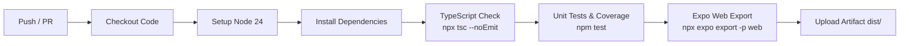

# Freshia — Deployment & Operations Guide

Dokumentasi ini menjelaskan arsitektur deployment, penanganan rahasia/kredensial (*environment variables*), integrasi CI/CD, dan langkah-langkah kompilasi build produksi untuk aplikasi seluler **Freshia** (IF671 Mobile Cross Platform Programming - Kelompok 5).

---

## 1. Environment & Credentials Handling (Keamanan Rahasia)

Sesuai dengan **NFR-02** dan standar keamanan industri, tidak ada kunci rahasia (*API keys*, kredensial cloud) yang di-hardcode ke dalam kode sumber git ataupun diekspos ke repositori publik:

1. **Pengembangan Lokal (`.env`)**:
   Kunci disimpan pada file `.env` di *root folder* yang telah terdaftar pada [`.gitignore`](file:///c:/Users/ASUS.KELLY-AMOREON/freshia/.gitignore) sehingga tidak akan ter-push ke GitHub.
   Variabel yang digunakan:
   - `EXPO_PUBLIC_GEMINI_API_KEY`: API Key Google Gemini (Vision Multimodal).
   - `EXPO_PUBLIC_ROBOFLOW_API_KEY`: API Key Roboflow Object Detection.
   - `EXPO_PUBLIC_ROBOFLOW_MODEL_ID`: ID Model klasifikasi buah Roboflow.
   - `EXPO_PUBLIC_CLOUDINARY_CLOUD_NAME`: Nama Cloudinary storage.
   - `EXPO_PUBLIC_CLOUDINARY_UPLOAD_PRESET`: Unsigned upload preset Cloudinary.
   - `EXPO_PUBLIC_GEMINI_MODEL`: (Opsional) Nama spesifik model Gemini (`gemini-2.5-flash` / `gemini-2.0-flash`).

2. **Lingkungan CI/CD (GitHub Secrets)**:
   Pada GitHub Actions, seluruh variabel lingkungan di atas didaftarkan di menu `Settings` $\rightarrow$ `Secrets and variables` $\rightarrow$ `Actions` sebagai *Encrypted Repository Secrets*.

3. **Kompilasi Seluler Cloud (EAS Secrets)**:
   Saat melakukan build APK/AAB di cloud EAS, rahasia diunggah menggunakan perintah CLI:
   ```bash
   npx eas-cli secret:create --scope project --name EXPO_PUBLIC_GEMINI_API_KEY --value <KEY>
   ```

---

## 2. CI/CD Pipeline (GitHub Actions)

Alur kerja otomatisasi (*Continuous Integration*) dikonfigurasi pada file [`.github/workflows/ci.yml`](file:///c:/Users/ASUS.KELLY-AMOREON/freshia/.github/workflows/ci.yml) yang berjalan otomatis pada setiap `push` dan `pull_request` ke cabang `master` dan `main`.

### Diagram Alur Pipeline:


---

## 3. Menjalankan Aplikasi Secara Lokal (Development)

### Prasyarat:
- Node.js versi 20 ke atas (disarankan Node v24).
- NPM versi 10+.
- Aplikasi **Expo Go** terinstal di smartphone Android atau iOS.

### Langkah-langkah:
1. **Clone Repositori:**
   ```bash
   git clone https://github.com/callistajb/freshia.git
   cd freshia
   ```
2. **Instal Dependensi:**
   ```bash
   npm install
   ```
3. **Konfigurasi Kunci Lingkungan:**
   Salin atau buat file `.env` di root folder dengan kredensial yang valid.
4. **Jalankan Unit Tests:**
   ```bash
   npm test
   ```
5. **Jalankan Server Metro Expo:**
   ```bash
   npx expo start -c
   ```
   Pindai QR Code menggunakan kamera smartphone (iOS) atau aplikasi Expo Go (Android).

---

## 4. Staging & Web Preview Environment

Untuk keperluan peninjauan UI dan evaluasi tim (*staging*), aplikasi dapat diekspor menjadi single page web bundle:
```bash
npx expo export -p web
```
Hasil build berada di folder `dist/` dan dapat di-hosting secara instan menggunakan:
- **Vercel**: `npx vercel --prod dist`
- **GitHub Pages**: Dihosting pada cabang `gh-pages` untuk review dosen dan penguji.

---

## 5. Build Produksi Android (EAS Cloud Build)

Aplikasi Freshia dikonfigurasi untuk kompilasi berkas rilis Android (AAB dan APK) melalui Expo Application Services (EAS):

1. **Login ke Akun EAS:**
   ```bash
   npx eas-cli login
   ```
2. **Inisialisasi Konfigurasi EAS:**
   ```bash
   npx eas-cli build:configure
   ```
3. **Build APK untuk Pengujian Internal (Internal Distribution):**
   ```bash
   npx eas-cli build --platform android --profile preview
   ```
4. **Build Android App Bundle (AAB) untuk Google Play Store:**
   ```bash
   npx eas-cli build --platform android --profile production
   ```
Berkas AAB yang dihasilkan siap diunggah ke Google Play Console pada track *Closed Testing* dengan target minimal 20 penguji internal terverifikasi (memenuhi kriteria penerimaan produk akhir Week 14).
