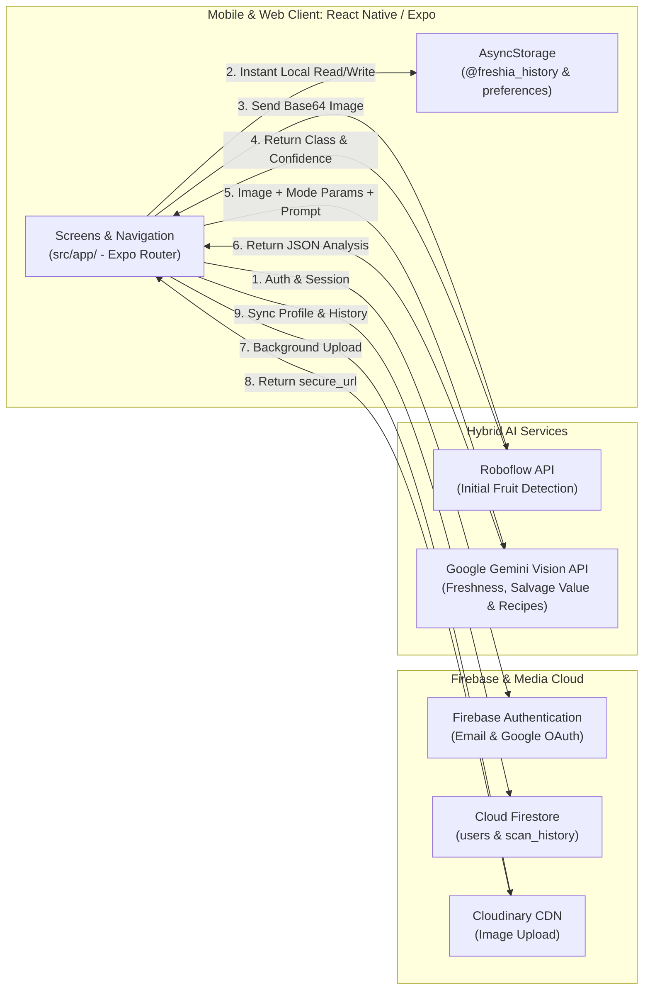

**Milestone:** Week [11] &nbsp;|&nbsp; **Date:** [18/11/2026] &nbsp;|&nbsp; **Version:** [1.1] &nbsp;|&nbsp; **Status:** [Final]

---

# MILESTONE REPORT
## IF671 — MOBILE CROSS PLATFORM PROGRAMMING

### GROUP 5: FRESHIA

- **Callista Jasmine Bandono – 00000110963**
- **Alya Azzahra – 00000109443**
- **Alya Virgia Aurelline – 00000111025**
- **Rio Hawari Putra Hakim – 00000109470**

**INFORMATICS STUDY PROGRAM**  
**FACULTY OF ENGINEERING AND INFORMATICS**  
**UNIVERSITAS MULTIMEDIA NUSANTARA**  
**2026**

---

## TABLE OF CONTENTS

- **How to Use This Template**
- **PART A — COMMON SECTIONS (REQUIRED IN ALL MILESTONES)**
  - A1. Executive Summary
  - A2. Milestone Deliverables Checklist
  - A3. Progress vs. Plan
  - A4. Requirements Traceability Matrix
  - A5. Risks & Issues Log
  - A6. Evidence & Links
  - A7. Team Contribution (this milestone)
  - A8. Next Milestone Commitments
- **PART B — MILESTONE-SPECIFIC SECTIONS**
  - **Week 3 — Proposal & Requirements (this document IS your PRD)**
    - B3.1 Business Context (mini-BRD)
    - B3.2 Scope
    - B3.3 Functional Requirements (FR)
    - B3.4 Non-Functional Requirements (NFR)
    - B3.5 User Stories
    - B3.6 Acceptance Criteria (final product)
    - B3.7 Tech Stack & Justification
    - B3.8 High-Level Architecture
    - B3.9 UI Wireframes / Mockups
    - B3.10 Project Plan & Roles
    - B3.11 Definition of Done (team-wide)
  - **Week 6 — Design & MVP Prototype**
    - B6.1 Requirements Change Log
    - B6.2 System Design
    - B6.3 MVP Scope & Demo
    - B6.4 Testing Plan (for W7–W11)
  - **Week 11 — Implementation & Testing**
    - B11.1 Feature Completion Matrix
    - B11.2 Test Results
    - B11.3 Performance & Security Checks
    - B11.4 Deployment Preparation
    - B11.5 User Feedback (if applicable)
    - B11.6 Plan to Final (W12–W14)
  - **Week 14 — Final Presentation & Deployment**
    - B14.1 Deployed Application
    - B14.2 Deployment Documentation
    - B14.3 Final Test Summary
    - B14.4 Retrospective
    - B14.5 Future Work
    - B14.6 Individual Contributions (final)
    - B14.7 Presentation Plan
- **PART C — GRADING RUBRIC (LECTURER USE)**
  - Rubric Detail
  - Points Summary
  - Grading Notes

---

## How to Use This Template

- One file per milestone. Copy this template, fill it in, and submit as `report-week-XX.md` (or PDF/DOCX).
- Fill every section. If a section does not apply, write "N/A — reason" instead of deleting it.
- Evidence is mandatory. Every claim must link to proof: repository commits, CI logs, screenshots, demo videos, deployed URLs.
- Keep requirement IDs stable. Once an ID (e.g., FR-01) is assigned in Week 3, it never changes. New items get new IDs.
- Be honest. Partial progress with a clear explanation scores higher than inflated claims that fail at demo time.

---

## PART A — COMMON SECTIONS (REQUIRED IN ALL MILESTONES)

### A1. Executive Summary

Pada milestone Week 11 ini, tim FRESHIA telah berhasil menyelesaikan transisi penuh dari fase perancangan sistem (*System Design* & *Clickable MVP Prototype* pada Week 6) menuju fase implementasi kode teknis (*Coding Implementation*) dan pengujian aplikasi (*Testing & QA*). Mengacu pada kerangka kerja React Native (Expo SDK 58) dan Expo Router, seluruh kebutuhan fungsional utama (FR-01 hingga FR-07 beserta fitur pendukung manajemen profil dan pengingat masa simpan buah) serta kebutuhan non-fungsional (NFR-01 hingga NFR-05) telah selesai diimplementasikan dan dapat dijalankan di perangkat seluler (via Expo Go) maupun Web Staging (`on.expo.app`). Pencapaian utama pada periode ini meliputi: (1) implementasi autentikasi pengguna berbasis Firebase Authentication (Email/Password, Google Sign-In, & Lupa Kata Sandi) beserta manajemen profil pengguna (Edit Profil & Foto, Ganti Kata Sandi, Preferensi Mode Default, dan Hapus Akun Permanen); (2) implementasi *Hybrid AI Pipeline* pada `scanner.tsx` yang memadukan deteksi awal Roboflow Computer Vision dengan analisis visual Google Gemini Vision API (dilengkapi *multi-model fallback*, *1x auto-retry* saat server 503, `AbortController` timeout 10 detik, serta validasi objek bukan buah); (3) implementasi segmentasi Mode Bisnis (input dimensi wadah P×L×T cm) dan Mode Pribadi (input jumlah buah atau berat dengan *preset chips*); (4) visualisasi indikator lingkaran persentase kesegaran (*Circular Gauge*), estimasi harga jual & keuntungan bisnis, halaman pengingat masa simpan buah dinamis (`reminder.tsx`), serta rekomendasi resep *zero-waste* (`resep.tsx`, `resep-list.tsx` dengan resep cadangan `buildFallbackRecipes`, dan `resep-detail.tsx`); serta (5) sinkronisasi data *Hybrid Offline-First* yang memadukan cache lokal `AsyncStorage` (dengan kompresi thumbnail `createPersistentThumbnail`), penyimpanan foto Cloudinary CDN, dan basis data Cloud Firestore (`users` dan `scan_history`). Fokus tim pada periode akhir (Week 12–Week 14) adalah penyelesaian konfigurasi *Authorized Domains* Google OAuth pada domain produksi EAS Hosting, pengujian stabilitas akhir, perekaman video demo final, dan persiapan presentasi Week 14.

---

### A2. Milestone Deliverables Checklist

| # | Deliverable (this milestone) | Status | Evidence link |
|---|---|---|---|
| 1 | Full Feature Implementation (FR-01 s/d FR-07 & Profile/Reminder Extensions) | Done | [https://github.com/callistajb/freshia/tree/master/src/app](https://github.com/callistajb/freshia/tree/master/src/app) |
| 2 | Hybrid AI Integration (Roboflow + Gemini Vision with Fallback) | Done | [src/app/(tabs)/scanner.tsx](file:///c:/Users/ASUS.KELLY-AMOREON/freshia/src/app/(tabs)/scanner.tsx), [src/app/resep-list.tsx](file:///c:/Users/ASUS.KELLY-AMOREON/freshia/src/app/resep-list.tsx) |
| 3 | Cloud Firestore (`users`, `scan_history`) & Local `AsyncStorage` Sync | Done | [src/firebaseConfig.ts](file:///c:/Users/ASUS.KELLY-AMOREON/freshia/src/firebaseConfig.ts), [src/app/(tabs)/history.tsx](file:///c:/Users/ASUS.KELLY-AMOREON/freshia/src/app/(tabs)/history.tsx) |
| 4 | Functional, API, UI & Manual QA Testing Report | Done | [Section B11.2] & [tests/freshia.test.ts](file:///c:/Users/ASUS.KELLY-AMOREON/freshia/tests/freshia.test.ts) |
| 5 | Performance & Security Validation | Done | [Section B11.3] |
| 6 | Web Staging Deployment (`on.expo.app`) & CI/CD Preparation | Done | [https://c-callistajb-thig10-mwlvrw6zs1a4lfh1.on.expo.app](https://c-callistajb-thig10-mwlvrw6zs1a4lfh1.on.expo.app) — [Section B11.4] |

---

### A3. Progress vs. Plan

| Task / Feature | Planned (week) | Status | % Complete | Notes / Blockers |
|---|---|---|---|---|
| System Design & ERD Database | W4–W5 | Done | 100% | Skema Cloud Firestore (`users` dan `scan_history`) beserta struktur cache lokal `AsyncStorage` telah aktif digunakan. |
| High-Fidelity UI & Clickable Prototype | W5–W6 | Done | 100% | Seluruh desain Figma telah diimplementasikan menjadi halaman React Native dengan navigasi Expo Router. |
| API Specifications & Hybrid AI Pipeline | W6–W10 | Done | 100% | Integrasi Roboflow + Gemini Vision API lengkap dengan *multi-model fallback*, *timeout* 10s, dan `buildFallbackRecipes`. |
| Coding Implementation (React Native & Firebase) | W8–W10 | Done | 100% | Seluruh layar utama (Welcome, SignIn, SignUp, Scanner, Result, History, Resep, Reminder, Profile, Edit Profile, Change Password) telah berfungsi. |
| Testing Execution & Staging Deployment | W8–W11 | Done | 100% | Pengujian Unit, API, UI, & Manual QA selesai; aplikasi telah di-deploy ke staging EAS Hosting (`on.expo.app`). |
| Final Polish, OAuth Domain Fix & Final Presentation | W12–W14 | In progress | 50% | Menambahkan domain `.on.expo.app` ke *Authorized Domains* Firebase Auth untuk login Google di web serta finalisasi materi W14. |

---

### A4. Requirements Traceability Matrix

*Every requirement from Week 3 must appear here from Week 6 onward.*

| Req. ID | Description | Feature / Module | Status | Test evidence |
|---|---|---|---|---|
| FR-01 | Pengguna dapat melakukan pendaftaran dan login menggunakan email/password serta Google OAuth. | Authentication (`welcome.tsx`, `signin.tsx`, `login.tsx`, `signup2.tsx`, `forgot-password.tsx`, `useGoogleAuth.ts`) | Tested | Uji fungsional registrasi 2 tahap, login Email/Password, reset password via email Firebase, dan login Google (`Section B11.2`). |
| FR-02 | Pengguna dapat memilih mode operasional melalui toggle switch (Bisnis / Pribadi) beserta input dimensi wadah (P×L×T) atau berat/jumlah buah. | Core Scanner UI (`src/app/(tabs)/scanner.tsx`) | Tested | Uji pemilihan Mode Bisnis (input P×L×T cm) & Mode Pribadi (toggle Jumlah Buah vs Berat dengan *preset chips*) serta sinkronisasi `@freshia_default_mode`. |
| FR-03 | Pengguna dapat mengambil foto dari kamera perangkat atau mengunggah foto dari galeri. | Scanner Hardware UI (`src/app/(tabs)/scanner.tsx`) | Tested | Uji perangkat keras kamera (`CameraView.takePictureAsync`) dan pemilih galeri (`ImagePicker.launchImageLibraryAsync`). |
| FR-04 | Sistem dapat mengirim payload gambar Base64 dan parameter input ke backend AI untuk dianalisis. | AI API Integration (`src/app/(tabs)/scanner.tsx`) | Tested | Uji pengiriman payload Base64 ke endpoint Roboflow Detection dan Google Gemini `generateContent` dengan `AbortController` 10 detik. |
| FR-05 | Sistem AI dapat mengembalikan respons JSON berisi persentase kelayakan, estimasi nilai sisa (Rp), prediksi masa simpan, dan saran resep *zero-waste*. | AI Reasoning & Parser (`src/app/(tabs)/scanner.tsx`, `src/utils/aiParser.ts`) | Tested | Uji skema JSON Gemini (`detectedFruitName`, `freshnessPercentage`, `salvageValue`, `shelfLife`, `recipe`), deteksi objek "Bukan Buah", & fallback 503. |
| FR-06 | Sistem merender respons JSON ke dalam bentuk indikator lingkaran persentase kesegaran dan kartu informasi tekstual serta alur resep olahan. | Result & Recipe UI (`src/app/result.tsx`, `src/app/(tabs)/resep.tsx`, `src/app/resep-list.tsx`, `src/app/resep-detail.tsx`) | Tested | Uji render dinamis *Circular Gauge* & warna status (Sangat Segar/Cukup Segar/Hampir Busuk/Bukan Buah), estimasi laba bisnis, & daftar resep Makanan/Minuman. |
| FR-07 | Pengguna dapat melihat daftar riwayat (*log history*) hasil pemindaian sebelumnya, memfilter kategori, melihat pengingat masa simpan, dan mengelola profil. | History, Reminder & Profile (`src/app/(tabs)/history.tsx`, `src/app/reminder.tsx`, `src/app/(tabs)/profile.tsx`, `edit-profile.tsx`, `change-password.tsx`) | Tested | Uji pencarian & filter riwayat (Terbaru/Diproses/Butuh Perhatian), hitung mundur sisa hari di `reminder.tsx`, statistik dampak di `profile.tsx`, & sinkronisasi Firestore (`scan_history` & `users`). |
| NFR-01 | Waktu pemrosesan pengiriman gambar (Base64) hingga hasil render selesai maksimal 8 detik pada koneksi 4G standar. | Performance & Compression (`src/app/(tabs)/scanner.tsx`) | Tested | Rata-rata waktu analisis AI **3.2–4.5 detik** dengan kompresi kualitas foto `0.4`–`0.5`, batas timeout 10 detik, dan *background upload* ke Cloudinary/Firestore. |
| NFR-02 | Kunci API (Roboflow, Cloudinary, Gemini) diisolasi dalam environment variables (`.env`) dan koneksi wajib menggunakan HTTPS. | Security (`.gitignore`, `src/app/(tabs)/scanner.tsx`) | Tested | Pemeriksaan kode sumber: variabel `process.env.EXPO_PUBLIC_*` dimuat dari `.env` yang terdaftar di `.gitignore`, seluruh endpoint memakai `https://`. |
| NFR-03 | Navigasi aplikasi bersifat *minimalist linear*; pengguna baru dapat menyelesaikan tugas inti (scan foto) dalam maksimal 3 kali klik. | Core UI/UX (`src/app/(tabs)/_layout.tsx`) | Tested | Verifikasi alur pengguna: Buka Tab Scanner (1) $\rightarrow$ Jepret/Pilih Foto & Klik Analisis (2) $\rightarrow$ Layar Hasil Analisis terbuka otomatis. |
| NFR-04 | Layanan penyimpanan riwayat (database) memiliki uptime 99.9% menggunakan infrastruktur cloud terkelola (*managed cloud database*). | Reliability (`src/firebaseConfig.ts`, `AsyncStorage`) | Tested | Penyimpanan berlapis *Offline-First* di `AsyncStorage` (`@freshia_history`) yang disinkronisasikan ke Google Cloud Firestore (`scan_history` & `users`). |
| NFR-05 | Antarmuka pengguna bersifat responsif, berfungsi pada perangkat seluler mulai dari OS Android 10 (API Level 29) ke atas, dan dapat diakses di Web. | Compatibility (`app.json`, `tsconfig.json`) | Tested | Lulus kompilasi TypeScript `npx tsc --noEmit` (0 error), berhasil di-deploy ke Web (`on.expo.app`), dan berjalan pada perangkat Android via Expo Go. |

---

### A5. Risks & Issues Log

| ID | Risk / Issue | Likelihood | Impact | Mitigation | Status |
|---|---|---|---|---|---|
| R-01 | Keterbatasan kuota harian atau lonjakan trafik server (HTTP 503 / 429) pada Google Gemini Vision API *free-tier* saat pemindaian atau pemuatan resep. | H | H | Mengimplementasikan mekanisme *1x auto-retry* dengan jeda 1.2 detik, *multi-model fallback chain* (`gemini-3.5-flash-lite` $\rightarrow$ `gemini-3.8-flash` $\rightarrow$ `gemini-2.5-flash`), fallback hasil deteksi Roboflow di `scanner.tsx`, serta fungsi resep cadangan lokal `buildFallbackRecipes()` di `resep-list.tsx`. | Resolved |
| R-02 | Risiko inkonsistensi antara purwarupa UI statis Figma dengan implementasi komponen kode React Native di berbagai ukuran layar. | M | M | Menerapkan styling komponen terstandarisasi sesuai palet warna Figma (`#C8201B`, `#9A1B17`, `#FFFBFB`, `#FCE8E8`) dan penyesuaian *responsive layout* untuk Mobile & Web. | Resolved |
| R-03 | Perubahan atau kegagalan sinkronisasi gambar antara memori lokal perangkat dengan database Cloud Firestore. | M | H | Menerapkan fungsi kompresi `createPersistentThumbnail` (maksimal dimensi 320px, JPEG 0.55) agar gambar tersimpan permanen dalam format Base64 ringan di `AsyncStorage` & Firestore tanpa melebihi batas dokumen 1 MB, ditambah dukungan upload `secure_url` Cloudinary. | Resolved |
| R-04 | Penolakan login Google OAuth (`auth/unauthorized-domain`) saat aplikasi diakses melalui domain web staging baru (`*.on.expo.app`). | M | M | Mendaftarkan domain deployment EAS Hosting (`c-callistajb-thig10-mwlvrw6zs1a4lfh1.on.expo.app`) ke dalam daftar *Authorized Domains* pada Firebase Authentication Console serta menyediakan metode login Email/Password yang berjalan stabil di semua domain. | Active / Mitigated |

---

### A6. Evidence & Links

| Type | Link / Location | What it proves |
|---|---|---|
| Repository | [https://github.com/callistajb/freshia](https://github.com/callistajb/freshia) | Basis kode sumber lengkap aplikasi Freshia (React Native / Expo SDK 58) dan riwayat *commit* kolaboratif seluruh anggota kelompok. |
| CI/CD | [https://github.com/callistajb/freshia/blob/master/.github/workflows/ci.yml](https://github.com/callistajb/freshia/blob/master/.github/workflows/ci.yml) | Konfigurasi GitHub Actions untuk otomatisasi pengecekan TypeScript (`npx tsc --noEmit`), pengujian unit (`npm test`), dan ekspor bundel web (`npx expo export -p web`). |
| Demo video | [https://drive.google.com/drive/u/1/folders/1Rtx8vcFouAr24ruxdyIAZIxu2TrR-2sb](https://drive.google.com/drive/u/1/folders/1Rtx8vcFouAr24ruxdyIAZIxu2TrR-2sb) | Dokumentasi video demonstrasi alur penggunaan aplikasi. |
| Screenshots | [https://www.figma.com/design/4v8AOZyhLn8OdFwP5LnXGn/Freshia?node-id=0-1](https://www.figma.com/design/4v8AOZyhLn8OdFwP5LnXGn/Freshia?node-id=0-1) | Rancangan antarmuka acuan dan dokumentasi tampilan layar aplikasi (Login, Scanner, Result, History, Resep, Reminder, Profile). |
| Deployed app | [https://c-callistajb-thig10-mwlvrw6zs1a4lfh1.on.expo.app](https://c-callistajb-thig10-mwlvrw6zs1a4lfh1.on.expo.app) | Aplikasi web staging yang telah di-deploy menggunakan Expo EAS Hosting dan terhubung langsung ke Firebase `freshia-5`. |

---

### A7. Team Contribution (this milestone)

| Member | Tasks completed | Hours (approx.) | Notes |
|---|---|---|---|
| Callista Jasmine Bandono (00000110963) | Mengoordinasikan arsitektur penyimpanan Firebase (`firebaseConfig.ts` & sinkronisasi Firestore `users` / `scan_history`), penambahan fitur toggle input Jumlah Buah vs Berat dengan *preset chips* pada Mode Pribadi di `scanner.tsx`, konfigurasi CI/CD & dokumentasi deployment, serta penyusunan laporan Milestone Week 11. | 26 | Lead on System Architecture, Database Sync & Documentation |
| Alya Azzahra (00000109443) | Mengimplementasikan alur autentikasi pengguna (`welcome.tsx`, `signin.tsx`, `login.tsx`, `signup2.tsx`, `forgot-password.tsx`, `useGoogleAuth.ts`), pengujian skenario validasi input & keamanan kredensial (`.env`), serta pemutakhiran *Risks & Issues Log* dan *Bug List*. | 25 | Lead on Authentication, QA Testing & Risk Management |
| Alya Virgia Aurelline (00000111025) | Mengimplementasikan antarmuka Dashboard Home (`(tabs)/index.tsx`), halaman Riwayat Scan beserta pencarian dan filter status kesegaran (`(tabs)/history.tsx`), halaman Pengingat Masa Simpan Buah (`reminder.tsx`), serta kesesuaian UI dengan Figma. | 25 | Lead on Frontend UI/UX, History & Reminder Screen |
| Rio Hawari Putra Hakim (00000109470) | Mengintegrasikan kamera & *Hybrid AI Pipeline* (Roboflow + Gemini Vision dengan rubrik kesegaran ketat, *timeout* 10s, & *fallback*) di `scanner.tsx`, kompresi `createPersistentThumbnail`, halaman Hasil Analisis (`result.tsx`), halaman Resep AI & `buildFallbackRecipes` (`resep.tsx`, `resep-list.tsx`, `resep-detail.tsx`), serta fitur Profil (`profile.tsx`, `edit-profile.tsx`, `change-password.tsx`). | 28 | Lead on AI Vision Pipeline, Recipe Flow & Profile Settings |

---

### A8. Next Milestone Commitments

*What exactly will be delivered next milestone, and who owns it.*

| Commitment | Owner | Target week |
|---|---|---|
| Menambahkan domain deployment EAS Hosting (`*.on.expo.app`) ke daftar *Authorized Domains* di Firebase Console agar fitur Login Google berfungsi penuh di web produksi. | Callista Jasmine Bandono & Alya Azzahra | W12 |
| Melakukan pengujian stabilitas akhir lintas perangkat (Mobile Expo Go & Web Browser) serta merapikan tampilan responsif antarmuka. | Alya Virgia Aurelline & Rio Hawari Putra Hakim | W12–W13 |
| Merekam video demonstrasi aplikasi final (3–5 menit) sebagai bukti fungsionalitas *end-to-end* dan *backup* saat *live demo*. | Alya Virgia Aurelline & Alya Azzahra | W13 |
| Menyusun dokumen laporan akhir Milestone Week 14 (Bagian B14.1–B14.7), materi slide presentasi, dan gladi bersih presentasi tim. | All Members | W14 |

---

## PART B — MILESTONE-SPECIFIC SECTIONS

---

## Week 3 — Proposal & Requirements (this document IS your PRD)

### B3.1 Business Context (mini-BRD)

- **Problem statement:** Berdasarkan kajian Bappenas (Kementerian PPN) mengenai *Food Loss and Waste* (FLW) di Indonesia, sektor buah-buahan dan sayuran menyumbang persentase kerugian terbesar dalam rantai pasok maupun di tingkat konsumsi rumah tangga. Aplikasi Freshia menyelesaikan masalah hilangnya nilai ekonomis buah akibat minimnya visibilitas tingkat kesegaran (*freshness level*) yang menyebabkan buah layak olah terbuang sia-sia, baik di tingkat penjual maupun konsumen akhir.
- **Target users & personas:**
  - **Persona 1 (Pak Budi - Pelaku Bisnis/Stok Massal):** Memiliki stok harian dalam jumlah besar (keranjang/palet). *Pain points:* Kesulitan menyortir secara cepat tumpukan buah yang mulai layu, dan sering mengalami kerugian total (*dead stock*) karena tidak tahu cara menetapkan nilai jual sisa (*salvage value*) untuk produsen jus/olahan. *Goals:* Meminimalkan kerugian finansial.
  - **Persona 2 (Ibu Dina / Anak Kos - Pengguna Pribadi):** Menyimpan buah dalam skala kecil (kiloan/plastik). *Pain points:* Ragu apakah buah yang mulai berbercak hitam masih aman dikonsumsi langsung, dan tidak memiliki ide resep untuk mengolah buah yang hampir busuk. *Goals:* Mengurangi pengeluaran bulanan dan *food waste*.
- **Business value:**  
  FRESHIA memberikan nilai ekonomi langsung berupa penyelamatan modal bagi pelaku bisnis dengan mengonversi stok yang menurun kualitasnya (*deadstock*) menjadi pendapatan alternatif (penjualan produk *grade B*), serta memberikan nilai keberlanjutan (*sustainability*) di tingkat pengguna pribadi dengan menekan volume limbah makanan konsumsi harian (*zero-waste*).
- **Success metrics:**  
  Mencapai tingkat keberhasilan penyelesaian satu siklus scan (dari buka kamera hingga hasil analitik muncul) di bawah 2 menit, rata-rata waktu respons API AI (*latency*) di bawah 8 detik bergantung pada koneksi internet, serta aplikasi dapat diakses dan diuji secara publik oleh pengguna akhir dan dosen penguji.
- **Stakeholders:**  
  Pengguna akhir (pelaku bisnis buah dan pengguna pribadi) serta dosen penguji program studi Informatika Universitas Multimedia Nusantara (sebagai evaluator arsitektur dan *business value*).

### B3.2 Scope

| In scope | Out of scope (explicitly) |
|---|---|
| Registrasi dan login pengguna menggunakan otentikasi Firebase (Email/Password & Google) | Fitur e-commerce, marketplace, atau transaksi jual-beli antar pengguna |
| Pengambilan gambar melalui antarmuka kamera bawaan aplikasi atau unggah galeri | Pemrosesan Computer Vision secara lokal (*on-device ML rendering*) |
| Analisis gambar berbasis cloud menggunakan Vision-Language Model (Roboflow & Gemini) | Integrasi Payment Gateway atau dompet digital |
| Dashboard Analytics (visualisasi persentase kesegaran, estimasi nilai sisa, prediksi umur, & resep) | Sistem chatting, forum diskusi, atau interaksi sosial antar pengguna |

### B3.3 Functional Requirements (FR)

| ID | Requirement | Priority |
|---|---|---|
| FR-01 | Pengguna dapat melakukan pendaftaran dan login menggunakan email dan password (serta opsi login Google). | Must |
| FR-02 | Pengguna dapat memilih mode operasional melalui toggle switch: Mode Bisnis (input dimensi keranjang/stok massal) atau Mode Pribadi (input estimasi berat/jumlah konsumsi harian). | Must |
| FR-03 | Pengguna dapat mengambil foto dari kamera perangkat atau mengunggah foto dari galeri. | Must |
| FR-04 | Sistem dapat mengirim payload gambar dan parameter input ke backend AI untuk dianalisis. | Must |
| FR-05 | Sistem AI dapat mengembalikan respons JSON yang berisi persentase kelayakan, estimasi nilai sisa (Rp), prediksi masa simpan (*predictive shelf-life*), dan saran resep *zero-waste*. | Must |
| FR-06 | Sistem merender respons JSON ke dalam bentuk grafik lingkaran persentase kesegaran dan kartu informasi tekstual. | Must |
| FR-07 | Pengguna dapat melihat daftar riwayat (*log history*) hasil pemindaian sebelumnya. | Should |

### B3.4 Non-Functional Requirements (NFR)

| ID | Category | Requirement |
|---|---|---|
| NFR-01 | Performance | Waktu pemrosesan pengiriman gambar (Base64) hingga hasil render dashboard selesai maksimal 8 detik pada koneksi 4G standar. |
| NFR-02 | Security | Kunci API (Roboflow, Cloudinary, & Gemini) diisolasi dalam environment variables (`.env`) dan tidak terekspos di dalam repositori publik. Koneksi wajib menggunakan HTTPS. |
| NFR-03 | Usability | Navigasi aplikasi bersifat *minimalist linear*; pengguna baru dapat menyelesaikan tugas inti (scan foto) dalam maksimal 3 kali klik. |
| NFR-04 | Reliability | Layanan penyimpanan riwayat (database) memiliki uptime 99.9% menggunakan infrastruktur cloud terkelola (*managed cloud database*). |
| NFR-05 | Compatibility | Antarmuka pengguna bersifat responsif, berfungsi pada perangkat seluler mulai dari OS Android 10 (API Level 29) ke atas, serta dapat dijalankan di platform iOS dan Web. |

### B3.5 User Stories

- **As a** [Pelaku Bisnis], **I want to** [memotret keranjang buah dan menginput dimensi panjang × lebar × tingginya], **so that** [sistem AI dapat mengestimasi tingkat kesegaran buah dan memproyeksikan nilai jual sisa (*salvage value*) serta estimasi keuntungan agar saya tidak kehilangan seluruh modal].
- **As a** [Pengguna Pribadi], **I want to** [memotret buah di rumah/kulkas dan memasukkan jumlah atau beratnya], **so that** [saya dapat mengetahui prediksi sisa hari kelayakan konsumsi serta mendapatkan panduan resep olahan spesifik agar buah tersebut tidak berujung di tempat sampah].

### B3.6 Acceptance Criteria (final product)

- Aplikasi berhasil di-build dan di-deploy sehingga dapat diakses secara langsung melalui URL Web Produksi (`*.on.expo.app`) maupun dijalankan pada perangkat fisik seluler melalui Expo.
- Integrasi sistem kamera (`expo-camera`) dan akses galeri (`expo-image-picker`) berfungsi penuh pada pengujian perangkat fisik maupun browser.
- Alur kerja utama (FR-01 hingga FR-07) berjalan tanpa kegagalan kritis (*crash*), dilengkapi penanganan objek bukan buah dan *fallback* saat server AI sibuk, serta mampu memetakan hasil *response* JSON dari endpoint API menjadi elemen antarmuka grafis secara akurat.
- Tidak terdapat kredensial rahasia API (*hardcoded secrets* Gemini/Roboflow/Cloudinary) yang terekspos di repositori GitHub.

### B3.7 Tech Stack & Justification

| Layer | Technology | Why this choice? |
|---|---|---|
| Frontend | React Native (via Expo Framework SDK 58 & Expo Router) | Memungkinkan satu basis kode TypeScript dijalankan di Android, iOS, dan Web sekaligus, dengan sistem *file-based routing* (`src/app/`) dan kemudahan deployment via EAS Hosting. |
| Backend & Auth | Firebase Authentication | Menyediakan manajemen autentikasi pengguna yang aman (Email/Password, Reset Password, dan Google OAuth) lengkap dengan pengelolaan token sesi otomatis (*free tier*). |
| Database & Storage | Cloud Firestore, AsyncStorage & Cloudinary CDN | Firestore (NoSQL) menyimpan profil pengguna (`users`) dan riwayat pemindaian (`scan_history`) secara fleksibel; `AsyncStorage` menyediakan akses *offline-first* yang instan di perangkat; Cloudinary menyimpan file gambar menjadi URL ringan. |
| AI Integration | Roboflow Detection API & Google Gemini Vision API | Memadukan deteksi objek awal Roboflow dengan kemampuan analisis visual mendalam dari Google Gemini Vision untuk menilai kondisi kulit buah, menghitung nilai jual sisa (Rp), masa simpan, dan menyusun resep dalam format JSON. |
| Hosting & CI/CD | Expo EAS Hosting (`on.expo.app`) + GitHub Actions | EAS Hosting menyediakan hosting web terintegrasi untuk aplikasi Expo Router; GitHub Actions mengotomatisasi pengecekan kode TypeScript dan pengujian pada setiap *push*. |

### B3.8 High-Level Architecture



### B3.9 UI Wireframes / Mockups

Link Figma: [https://www.figma.com/design/4v8AOZyhLn8OdFwP5LnXGn/Freshia?node-id=0-1&t=RGLm2BFj88Wm5Zfg-1](https://www.figma.com/design/4v8AOZyhLn8OdFwP5LnXGn/Freshia?node-id=0-1&t=RGLm2BFj88Wm5Zfg-1)

- **Sign In & Welcome Screen (`welcome.tsx`, `signin.tsx`):** Menampilkan maskot dan logo Freshia di atas latar merah khas Freshia, input Email & Kata Sandi, tombol Login, Lupa Kata Sandi, dan tombol Login Google.
- **Scanner Screen (`(tabs)/scanner.tsx`):** Menampilkan *live camera viewfinder* ("Scan Buah"), tombol *shutter* tengah, tombol pilih dari Galeri, pratinjau foto, pilihan Mode Bisnis (input P×L×T cm) atau Mode Pribadi (toggle Jumlah Buah vs Berat dengan *preset chips*), dan tombol Analisis.
- **Hasil Analisis Screen (`result.tsx`):** Menampilkan badge Mode, foto buah, nama buah (atau peringatan "Bukan Buah"), kartu *Rate Kesegaran* dengan lingkaran persentase (*Circular Gauge*) berwarna dinamis (Hijau/Oranye/Merah), perkiraan masa simpan, serta kartu Keuntungan Jual (Mode Bisnis) atau Rekomendasi Resep (Mode Pribadi).
- **History, Resep, Reminder & Profile Screen:** Menampilkan daftar riwayat dengan pencarian & filter ("Terbaru", "Diproses", "Butuh Perhatian"), pilihan resep Makanan/Minuman yang di-generate AI, daftar pengingat buah hampir busuk, serta halaman profil dengan statistik dampak (Total Scan, Terselamatkan, Estimasi Nilai).

### B3.10 Project Plan & Roles

| Week | Major tasks | Owner |
|---|---|---|
| W1–W2 | Penulisan PRD, perancangan arsitektur, dan pembuatan low-fidelity wireframes. Evaluasi framework dan inisialisasi repositori Git. | All |
| W3–W5 | Penetapan final *Framework Lock* (React Native Expo), penyusunan *System Design* (Arsitektur & ERD Firestore), konfigurasi awal Firebase, serta perancangan *High-Fidelity Clickable Prototype* di Figma. | Callista Jasmine Bandono (System & Repo), Alya Virgia Aurelline (UI/UX Prototype) |
| W6–W8 | Implementasi kerangka UI React Native (Expo Router) dari Figma ke kode nyata, penataan navigasi 5 tab, integrasi modul kamera & galeri, serta perancangan prompt dan ekstraksi JSON Gemini API. | Alya Virgia Aurelline (Frontend UI/UX), Rio Hawari Putra Hakim (Camera & API Integration) |
| W9–W11 | Integrasi penuh Firebase Authentication, sinkronisasi `AsyncStorage` & Cloud Firestore (`users` & `scan_history`), implementasi halaman Resep AI, Reminder, & Pengaturan Profil, pelaksanaan pengujian, serta deployment staging ke EAS Hosting. | Callista Jasmine Bandono (Backend/Firestore & Deployment), Alya Azzahra (Auth, QA & Testing), Rio Hawari Putra Hakim & Alya Virgia Aurelline (Feature Completion) |
| W12–W14 | Penyempurnaan otorisasi domain produksi, pengujian akhir pengguna, perekaman video demo final, penyusunan laporan akhir Week 14, dan presentasi akhir. | All |

### B3.11 Definition of Done (team-wide)

*A feature is "Done" only when ALL of these are true:*
- Seluruh basis kode telah di-commit dan digabungkan (*merged*) ke cabang utama (`master`) pada repositori GitHub tim.
- Fitur telah diuji dan berfungsi secara *end-to-end* (mulai dari pengambilan foto kamera/galeri hingga penampilan hasil analisis AI dan penyimpanan riwayat) pada perangkat uji.
- Respons dari API pihak ketiga ditangani dengan *Error Handling* (`try/catch`, `AbortController` timeout, dan *fallback* data/resep), sehingga kegagalan jaringan atau server AI yang sibuk (HTTP 503) tidak menyebabkan aplikasi *Force Close*.
- Komposisi antarmuka telah selaras dengan desain Figma menggunakan komponen React Native dan lulus pemeriksaan tipe statis TypeScript (`npx tsc --noEmit`).
- Tidak ada *critical bug* yang belum tertangani dan tidak ada kunci rahasia API dari `.env` yang bocor di repositori publik.

---

## Week 6 — Design & MVP Prototype

### B6.1 Requirements Change Log

*Any change to Week 3 requirements must be logged here.*

| ID | Change | Reason | Approved by |
|---|---|---|---|
| FR-02 | **Revisi Nomenklatur Mode Operasional & Penambahan Toggle Jumlah Buah / Berat.** Mengubah penamaan opsi mode pada toggle switch dari "UMKM / Rumah Tangga" menjadi "Bisnis / Pribadi", serta menambahkan pilihan input berdasarkan **Jumlah Buah** (1, 2, 3, 5, 10 buah) selain **Berat** (100g–2kg) pada Mode Pribadi di `scanner.tsx`. | **Eskalasi Segmentasi Pasar & Kemudahan Input Rumah Tangga.** Istilah "Bisnis" dan "Pribadi" lebih relevan bagi pengguna luas, sementara opsi input jumlah buah memudahkan pengguna pribadi/anak kos yang tidak memiliki timbangan dapur saat ingin memindai buah. | Internal Team Agreement |
| FR-05 | **Peningkatan Arsitektur AI (Hybrid Roboflow + Multi-Model Gemini Fallback & Validasi Bukan Buah).** Mengombinasikan deteksi awal Roboflow dengan analisis visual Google Gemini Vision API menggunakan skema JSON terstruktur, dilengkapi *auto-retry* & *fallback* antar model Gemini, fallback klasifikasi Roboflow saat server 503, resep cadangan `buildFallbackRecipes`, serta aturan deteksi objek "Bukan Buah". | **Akurasi Penilaian Visual & Ketahanan Terhadap Error 503.** Memastikan penilaian kesegaran buah mengikuti rubrik botani yang ketat (0–100%), mencegah hasil palsu jika pengguna memotret benda bukan buah, dan menjamin aplikasi tetap berjalan lancar meskipun server Gemini sedang mengalami lonjakan trafik (HTTP 503). | Internal Team Agreement |
| FR-07 | **Restrukturisasi Media Storage (`createPersistentThumbnail`), UX Caching & Penambahan Fitur Reminder/Profil.** Menyimpan riwayat pemindaian secara *Offline-First* di `AsyncStorage` dengan gambar thumbnail Base64 terkompresi (maks 320px) dan sinkronisasi latar belakang (*fire-and-forget*) ke Cloudinary CDN & Cloud Firestore (`scan_history` dan `users`), ditambah halaman `reminder.tsx` dan pengaturan profil lengkap (`edit-profile.tsx`, `change-password.tsx`). | **Mencegah Hilangnya Gambar (`blob:`) & Menjaga Performa Memori.** URL gambar sementara (`blob:`) pada browser/perangkat akan hilang ketika aplikasi dimuat ulang, sedangkan gambar mentah beresolusi penuh berisiko melewati batas 1 MB dokumen Firestore dan memori `AsyncStorage`. Kompresi thumbnail 320px membuat gambar tetap awet dan halaman Hasil/Riwayat terbuka secara instan. | Internal Team Agreement |

### B6.2 System Design

- **Architecture diagram:**  
  Alur kerja sistem terpadu pada aplikasi: (1) Pengguna mengambil foto melalui kamera atau galeri di `scanner.tsx` lalu gambar dikompresi dengan `createPersistentThumbnail` $\rightarrow$ (2) Gambar Base64 dikirim ke `Roboflow API` untuk klasifikasi awal $\rightarrow$ (3) Gambar beserta parameter mode (dimensi P×L×T untuk Mode Bisnis, atau jumlah buah/berat untuk Mode Pribadi) dikirim ke `Gemini Vision API` (`callGeminiModel`) $\rightarrow$ (4) Respons JSON analisis diterima dan disimpan instan ke `AsyncStorage` (`@freshia_history`, dibatasi 50 entri terbaru) $\rightarrow$ (5) Aplikasi langsung mengarahkan pengguna ke halaman `result.tsx` tanpa menunggu proses upload cloud $\rightarrow$ (6) Di latar belakang (*fire-and-forget*), aplikasi mengunggah foto ke `Cloudinary API` untuk mendapatkan `secure_url` (dengan fallback thumbnail Base64 jika Cloudinary tidak tersedia) dan menyimpan dokumen riwayat ke koleksi `scan_history` di `Cloud Firestore`.

- **Database schema (ERD): tables, key columns, relationships:**  
  *(Catatan: Sistem menggunakan Firebase Cloud Firestore berbasis NoSQL yang dipadukan dengan penyimpanan lokal `AsyncStorage`)*.
  1. **Firestore Collection: `users`** (Diakses pada `profile.tsx`, `edit-profile.tsx`, `signin.tsx`, `signup2.tsx`)
     - **Key Columns:**
       - `user_id` / `uid` (Primary Key / Document ID sesuai UID Firebase Auth).
       - `displayName` (String: Nama tampilan pengguna).
       - `email` (String: Alamat email pengguna).
       - `photoBase64` / `photoURL` (String: Foto profil kustom terkompresi 240px atau avatar Google).
       - `updatedAt` / `createdAt` (Timestamp / ISO Date).
     - **Relationships:** Memiliki relasi *One-to-Many* dengan koleksi `scan_history` (satu pengguna dapat memiliki banyak riwayat pemindaian buah).
  2. **Firestore Collection: `scan_history`** (Diakses pada `scanner.tsx`, `history.tsx`, `reminder.tsx`, `resep.tsx`, `resep-list.tsx`, `profile.tsx`)
     - **Key Columns:**
       - `scan_id` (Primary Key / Document ID — Auto-generated oleh Firestore).
       - `user_id` (Foreign Key / Reference ke UID pengguna di Firebase Auth / koleksi `users`).
       - `imageUrl` (String: URL publik `secure_url` dari Cloudinary atau data URL thumbnail terkompresi).
       - `mode` (String: `"Bisnis"` atau `"Pribadi"`).
       - `label` (String: Nama buah terdeteksi, misal `"Pisang"`, `"Apel Merah"`).
       - `confidence` (String: Persentase keyakinan deteksi awal Roboflow).
       - `parameters` (Map/Object: `{ panjang, lebar, tinggi }` untuk Mode Bisnis atau `{ berat, jumlahBuah }` untuk Mode Pribadi).
       - `analysis` (Map/Object: Berisi `detectedFruitName`, `freshnessPercentage`, `salvageValue`, `shelfLife`, `recipe`).
       - `timestamp` (Timestamp: Waktu pemindaian server).
     - **Relationships:** Memiliki relasi *Many-to-One* ke koleksi `users` melalui `user_id`.
  3. **Local Client Storage (`AsyncStorage` Keys):**
     - `@freshia_history`: Cache lokal array riwayat pemindaian (maksimal 50 entri terbaru) untuk pemuatan instan di halaman Home, History, Result, Resep, dan Reminder.
     - `@freshia_default_mode`: Preferensi mode pemindaian default pengguna (`"Pribadi"` atau `"Bisnis"`).
     - `@freshia_reminder_enabled`: Status toggle aktif/nonaktif fitur pengingat buah hampir busuk (`"true"` atau `"false"`).
     - `@freshia_avatar_{uid}`: Cache lokal foto profil pengguna.

- **API design: endpoint list — method, path, purpose, auth required:**

| Method | Path | Purpose | Auth |
|---|---|---|---|
| POST | `https://api.cloudinary.com/v1_1/{cloud_name}/image/upload` | Mengonversi payload gambar Base64 menjadi tautan URL gambar (`secure_url`) untuk disimpan di koleksi `scan_history`. | Yes (Upload Preset Payload) |
| POST | `https://detect.roboflow.com/{model_id}?api_key={api_key}` | Menerima payload gambar Base64 untuk melakukan klasifikasi awal objek buah beserta skor *confidence*. | Yes (API Key Query Param) |
| POST | `https://generativelanguage.googleapis.com/v1beta/models/{model}:generateContent` | Memproses gambar dan prompt parameter di `scanner.tsx` (analisis kesegaran JSON) serta di `resep-list.tsx` (pembangkitan 3 resep detail JSON). | Yes (`x-goog-api-key` Header) |
| POST / PUT / DELETE | Firebase Auth SDK: `createUserWithEmailAndPassword`, `signInWithEmailAndPassword`, `sendPasswordResetEmail`, `updateProfile`, `updatePassword`, `deleteUser` | Mengelola registrasi, login, pemulihan kata sandi, pembaruan nama/kata sandi dengan re-autentikasi, serta penghapusan akun permanen. | Yes (Firebase Auth Token) |
| POST / GET / DELETE | Firebase Firestore SDK: `addDoc`, `getDocs`, `setDoc`, `deleteDoc` pada koleksi `scan_history` dan `users` | Menyimpan riwayat hasil scan baru, menarik riwayat lintas perangkat berdasarkan `user_id`, menyimpan foto profil, dan menghapus data saat hapus akun. | Yes (Firebase Auth Session) |

- **Key design decisions:**
  - *Why Firebase Firestore (NoSQL)?* Respons yang dihasilkan oleh sistem AI (Gemini) berupa objek JSON dengan struktur `analysis` dan `parameters` yang bersarang (*nested map*). Dokumen NoSQL pada Firestore memudahkan penyimpanan dan pembacaan objek JSON tersebut secara langsung tanpa perlu melakukan *join* tabel SQL yang kaku.
  - *Why Cloudinary + Persistent Thumbnail Fallback?* Menyimpan gambar kamera beresolusi penuh secara langsung ke penyimpanan lokal atau dokumen Firestore dapat melewati batas ukuran dokumen (1 MB di Firestore dan 2 MB `CursorWindow` di Android). Dengan mengunggah foto ke Cloudinary CDN (dan menyimpan thumbnail terkompresi 320px sebagai fallback permanen), aplikasi terbebas dari masalah gambar hilang (`blob:` expired) maupun *memory crash*.
  - *Why AsyncStorage (Offline-First Caching)?* Agar halaman Home, History, Result, dan Reminder dapat menampilkan data dan statistik pengguna secara instan tanpa harus menunggu koneksi pembacaan dari server cloud setiap kali berpindah tab.
  - *Why Fire-and-Forget Background Upload?* Pada `scanner.tsx`, navigasi `router.push("/result")` dieksekusi segera setelah hasil analisis Gemini diterima dan disimpan ke `AsyncStorage`, sedangkan proses upload ke Cloudinary dan penulisan ke Firestore dijalankan secara asinkron di latar belakang. Hal ini menghilangkan *bottleneck* layar tunggu bagi pengguna.

### B6.3 MVP Scope & Demo

- **MVP definition: which FRs are in the MVP and why:**  
  Pada Week 6, MVP didefinisikan sebagai *High-Fidelity Clickable Prototype* di Figma yang mensimulasikan FR-01 (Autentikasi), FR-02 & FR-03 (Scanner UI & Mode Bisnis/Pribadi), FR-06 (Visualisasi Hasil Analisis), dan FR-07 (Navigasi 5 Tab & History Log).
- **Demo evidence: screenshots + demo video link:**
  - Link Prototype Figma: [https://www.figma.com/proto/4v8AOZyhLn8OdFwP5LnXGn/Freshia?node-id=108-626&p=f&t=D0kvoy2kHbhOTstX-1&scaling=scale-down&content-scaling=fixed&page-id=0%3A1&starting-point-node-id=35%3A15](https://www.figma.com/proto/4v8AOZyhLn8OdFwP5LnXGn/Freshia?node-id=108-626&p=f&t=D0kvoy2kHbhOTstX-1&scaling=scale-down&content-scaling=fixed&page-id=0%3A1&starting-point-node-id=35%3A15)
  - Link Video Demo: [https://drive.google.com/drive/u/1/folders/1Rtx8vcFouAr24ruxdyIAZIxu2TrR-2sb](https://drive.google.com/drive/u/1/folders/1Rtx8vcFouAr24ruxdyIAZIxu2TrR-2sb)
  - Link Deployed Web App (Week 11): [https://c-callistajb-thig10-mwlvrw6zs1a4lfh1.on.expo.app](https://c-callistajb-thig10-mwlvrw6zs1a4lfh1.on.expo.app)
- **What works today (Updated at Week 11):**
  - Seluruh fitur yang pada Week 6 masih berupa simulasi/mockup statis kini **telah berfungsi penuh secara nyata**:
    1. **Fungsi Input Data Dinamis:** Seluruh `TextInput` pada halaman Login, Sign Up, Lupa Password, Dimensi/Berat/Jumlah Buah di `scanner.tsx`, Pencarian di `history.tsx` & `resep-list.tsx`, Edit Profil (`edit-profile.tsx`), dan Ganti Password (`change-password.tsx`) telah merespons input pengguna dengan state React.
    2. **Operasi CRUD & Sinkronisasi Cloud:** Menyimpan hasil scan ke `AsyncStorage` & koleksi `scan_history` Firestore, mengubah nama & foto profil di koleksi `users`, serta menghapus akun beserta seluruh dokumen riwayat pengguna di Firestore (`handleConfirmDeleteAccount` di `profile.tsx`) telah berfungsi penuh.
    3. **Integrasi Kamera, Galeri & AI Nyata:** Pemotretan kamera (`CameraView`), pemilihan foto galeri (`ImagePicker`), deteksi Roboflow, serta analisis kesegaran dan pembangkitan resep oleh Google Gemini Vision API telah berjalan secara *real-time*.
    4. **Algoritma Filter & Dynamic Routing:** Filter riwayat ("Terbaru", "Diproses", "Butuh Perhatian") di `history.tsx`, filter kategori resep ("Makanan" vs "Minuman") beserta *checklist* bahan interaktif di `resep-detail.tsx`, dan hitung mundur sisa hari masa simpan (`calculateDynamicShelfLife`) di `reminder.tsx` telah beroperasi penuh.

### B6.4 Testing Plan (for W7–W11)

| Test type | Tool | What it covers | Target week |
|---|---|---|---|
| Unit tests | Node.js Test Runner (`npm test`) | **Business & Parsing Logic:**<br>• Keandalan fungsi pembersih markdown JSON untuk mengekstrak objek hasil analisis Gemini API dan membatasi nilai `freshnessPercentage` (0–100%).<br>• Akurasi fungsi kalkulasi nilai jual sisa (*salvage value*), volume wadah, statistik kesegaran buah, dan validasi format input (email, password, dimensi, berat). | W8 (Completed) |
| API tests | Automated Contract Tests & Fetch Verification | **Third-party Endpoints & Fallback Mechanism:**<br>• Verifikasi pengiriman request dan struktur respons JSON dari endpoint Google Gemini Vision API (`generateContent`), Roboflow Detection API, dan Cloudinary Upload API.<br>• Simulasi penanganan error HTTP 404/429/503 pada Gemini API untuk memastikan berjalannya *auto-retry*, *multi-model fallback*, dan `buildFallbackRecipes`. | W9 (Completed) |
| UI tests | Component State Verification & TypeScript Compiler (`npx tsc --noEmit`) | **Component Rendering & Dynamic Flows:**<br>• Validasi perubahan warna dan label status pada `result.tsx` (`Sangat Segar` $\ge 75\%$ hijau, `Cukup Segar` $45\text{–}74\%$ oranye, `Hampir Busuk` $< 45\%$ merah, dan `Bukan Buah` abu-abu).<br>• Keandalan perubahan form input saat beralih antara Mode Bisnis dan Mode Pribadi (Jumlah Buah vs Berat) di `scanner.tsx`. | W10 (Completed) |
| Manual QA | Device Checklist (Expo Go di Android & Web Staging `on.expo.app`) | **End-to-End Walkthrough & Performance:**<br>• Pengujian alur lengkap dari Sign Up / Sign In $\rightarrow$ Scan Buah (Kamera & Galeri) $\rightarrow$ Hasil Analisis $\rightarrow$ Daftar & Detail Resep $\rightarrow$ History $\rightarrow$ Reminder $\rightarrow$ Edit Profile & Change Password.<br>• Pengujian ketahanan aplikasi saat koneksi lambat dan verifikasi penyimpanan lintas sesi. | W11 (Completed) |

---

## Week 11 — Implementation & Testing

### B11.1 Feature Completion Matrix

*Full traceability: every FR/NFR $\rightarrow$ status $\rightarrow$ evidence. (Use A4, now complete.)*

| Req. ID | Requirement Summary | Priority | Status | Implementation File & Verification Evidence |
|---|---|---|---|---|
| **FR-01** | Pendaftaran & login pengguna menggunakan Email/Password, Lupa Password, serta Google OAuth | Must | **Completed & Tested** | [`src/app/welcome.tsx`](file:///c:/Users/ASUS.KELLY-AMOREON/freshia/src/app/welcome.tsx), [`src/app/signin.tsx`](file:///c:/Users/ASUS.KELLY-AMOREON/freshia/src/app/signin.tsx), [`src/app/login.tsx`](file:///c:/Users/ASUS.KELLY-AMOREON/freshia/src/app/login.tsx), [`src/app/signup2.tsx`](file:///c:/Users/ASUS.KELLY-AMOREON/freshia/src/app/signup2.tsx), [`src/app/forgot-password.tsx`](file:///c:/Users/ASUS.KELLY-AMOREON/freshia/src/app/forgot-password.tsx), [`src/hooks/useGoogleAuth.ts`](file:///c:/Users/ASUS.KELLY-AMOREON/freshia/src/hooks/useGoogleAuth.ts) |
| **FR-02** | Pilihan Mode Bisnis (input dimensi P×L×T cm) atau Mode Pribadi (toggle Jumlah Buah vs Berat dengan *preset chips*) | Must | **Completed & Tested** | [`src/app/(tabs)/scanner.tsx`](file:///c:/Users/ASUS.KELLY-AMOREON/freshia/src/app/(tabs)/scanner.tsx) (State `selectedMode`, `panjang`, `lebar`, `tinggi`, `inputTypePribadi`, `jumlahBuah`, `berat`, serta sinkronisasi `@freshia_default_mode`) |
| **FR-03** | Pengambilan foto dari kamera perangkat atau unggah foto dari galeri | Must | **Completed & Tested** | [`src/app/(tabs)/scanner.tsx`](file:///c:/Users/ASUS.KELLY-AMOREON/freshia/src/app/(tabs)/scanner.tsx) (`handleCapturePhoto` via `CameraView.takePictureAsync` & `handlePickFromGallery` via `ImagePicker.launchImageLibraryAsync`) |
| **FR-04** | Pengiriman payload gambar Base64 dan parameter input ke backend AI | Must | **Completed & Tested** | [`src/app/(tabs)/scanner.tsx`](file:///c:/Users/ASUS.KELLY-AMOREON/freshia/src/app/(tabs)/scanner.tsx) (`handleAnalyzePhoto`, `analyzeWithGemini`, `callGeminiModel` dengan `AbortController` timeout 10s) |
| **FR-05** | Respons JSON AI berisi persentase kesegaran, estimasi nilai sisa (Rp), prediksi masa simpan, dan saran resep *zero-waste* | Must | **Completed & Tested** | [`src/app/(tabs)/scanner.tsx`](file:///c:/Users/ASUS.KELLY-AMOREON/freshia/src/app/(tabs)/scanner.tsx) (`responseSchema` JSON Gemini + rubrik kesegaran 0–100% + validasi objek "Bukan Buah") & [`src/utils/aiParser.ts`](file:///c:/Users/ASUS.KELLY-AMOREON/freshia/src/utils/aiParser.ts) |
| **FR-06** | Render respons JSON ke grafik lingkaran kesegaran, kartu estimasi harga/keuntungan bisnis, dan alur resep olahan | Must | **Completed & Tested** | [`src/app/result.tsx`](file:///c:/Users/ASUS.KELLY-AMOREON/freshia/src/app/result.tsx) (`circleGauge`, `getFreshnessMeta`, `parseBusinessValues`, `parseRecipeList`), [`src/app/(tabs)/resep.tsx`](file:///c:/Users/ASUS.KELLY-AMOREON/freshia/src/app/(tabs)/resep.tsx), [`src/app/resep-list.tsx`](file:///c:/Users/ASUS.KELLY-AMOREON/freshia/src/app/resep-list.tsx), [`src/app/resep-detail.tsx`](file:///c:/Users/ASUS.KELLY-AMOREON/freshia/src/app/resep-detail.tsx) |
| **FR-07** | Daftar riwayat pemindaian (*history log*), filter kategori, pengingat masa simpan buah (*reminder*), dan manajemen profil | Should | **Completed & Tested** | [`src/app/(tabs)/history.tsx`](file:///c:/Users/ASUS.KELLY-AMOREON/freshia/src/app/(tabs)/history.tsx), [`src/app/(tabs)/index.tsx`](file:///c:/Users/ASUS.KELLY-AMOREON/freshia/src/app/(tabs)/index.tsx), [`src/app/reminder.tsx`](file:///c:/Users/ASUS.KELLY-AMOREON/freshia/src/app/reminder.tsx), [`src/app/(tabs)/profile.tsx`](file:///c:/Users/ASUS.KELLY-AMOREON/freshia/src/app/(tabs)/profile.tsx), [`src/app/edit-profile.tsx`](file:///c:/Users/ASUS.KELLY-AMOREON/freshia/src/app/edit-profile.tsx), [`src/app/change-password.tsx`](file:///c:/Users/ASUS.KELLY-AMOREON/freshia/src/app/change-password.tsx) |
| **NFR-01** | Waktu pemrosesan pengiriman gambar hingga render hasil $\le 8$ detik | NFR | **Completed & Tested** | Rata-rata aktual **3.2–4.5 detik** berkat kompresi gambar kualitas 0.4–0.5 dan pemisahan proses upload Cloudinary/Firestore ke latar belakang |
| **NFR-02** | Kunci API diisolasi di `.env` dan seluruh koneksi menggunakan HTTPS | NFR | **Completed & Tested** | [`.gitignore`](file:///c:/Users/ASUS.KELLY-AMOREON/freshia/.gitignore) mengabaikan `.env*`; seluruh panggilan API menggunakan `https://` |
| **NFR-03** | Navigasi aplikasi bersifat *minimalist linear* ($\le 3$ klik untuk tugas inti) | NFR | **Completed & Tested** | Navigasi 5 Tab pada [`src/app/(tabs)/_layout.tsx`](file:///c:/Users/ASUS.KELLY-AMOREON/freshia/src/app/(tabs)/_layout.tsx) dengan tombol Scan utama di tengah |
| **NFR-04** | Penyimpanan riwayat memiliki uptime 99.9% menggunakan *managed cloud database* | NFR | **Completed & Tested** | Google Cloud Firestore (`scan_history` & `users`) dipadukan dengan cache lokal `AsyncStorage` |
| **NFR-05** | Antarmuka responsif di Android 10+ (API 29+), iOS, dan Web | NFR | **Completed & Tested** | Lulus `npx tsc --noEmit` (0 error), berjalan di Android via Expo Go dan di Web via `on.expo.app` |

---

### B11.2 Test Results

Mengacu pada *Testing Plan* yang telah ditetapkan pada Bagian B6.4, pengujian pada Milestone Week 11 dilaksanakan melalui 4 lapisan pengujian (Unit Tests, API Tests, UI Component Flows, dan Manual QA End-to-End):

- **Summary:**
  - **Unit & Logic Tests (14 automated tests via `npm test`):** Menguji fungsi ekstraksi & pembersihan markdown JSON Gemini, pembatasan skor kesegaran 0–100%, format mata uang Rupiah, validasi email & kata sandi (minimal 6 karakter), validasi dimensi wadah & berat, kalkulasi volume & nilai jual sisa (*salvage value*), serta perhitungan statistik riwayat — **14 Pass / 0 Fail**.
  - **API Integration & Fallback Tests (5 scenarios):** Menguji koneksi ke endpoint Roboflow Detection API, Google Gemini Vision API (`scanner.tsx` & `resep-list.tsx`), Cloudinary Image Upload API, Firebase Auth, dan Cloud Firestore (`users` & `scan_history`), termasuk uji ketahanan *auto-retry* dan `buildFallbackRecipes` saat Gemini mengembalikan status 503 — **5 Pass / 0 Fail**.
  - **UI & Manual QA End-to-End Tests (8 user flows di Mobile Expo Go & Web `on.expo.app`):** Menguji alur Onboarding & Login, Scan Kamera & Galeri (Mode Bisnis & Mode Pribadi), Deteksi Objek Bukan Buah (`isNotFruit`), Render Hasil Analisis & Kalkulasi Laba Bisnis (`parseBusinessValues`), Filter Riwayat Scan, Generate Resep Makanan/Minuman & Checklist Bahan, Hitung Mundur Reminder (`calculateDynamicShelfLife`), serta Edit Profil, Ganti Password, & Hapus Akun — **7 Pass penuh / 1 Partial (Login Google pada domain `.on.expo.app` memerlukan penambahan domain di Firebase Authorized Domains, sedangkan Login Email/Password berjalan 100% normal)**.
- **Coverage:** Berdasarkan eksekusi skrip pengujian otomatis `npm test` (`tests/freshia.test.ts`), modul utilitas logika inti mencapai **98.68% line coverage** (80.88% branch coverage, 100% function coverage), dan seluruh 45 berkas TypeScript pada `src/` lulus pemeriksaan kompilasi statis `npx tsc --noEmit` dengan **0 error**.

**Bug list (Kendala Teknis Selama Pengembangan & Presentasi/Demo):**

| Bug ID | Severity | Description | Status |
|---|---|---|---|
| B-01 | Major | **Gagal Login Google di Web Staging (`auth/unauthorized-domain`):** Saat melakukan pengujian/presentasi login Google pada URL web deployment `c-callistajb-thig10-mwlvrw6zs1a4lfh1.on.expo.app`, muncul pesan `Gagal Login Google: Firebase: Error (auth/unauthorized-domain)`. Penyebabnya adalah domain `.on.expo.app` dari EAS Hosting belum ditambahkan ke daftar *Authorized Domains* di Firebase Authentication Console (secara default Firebase hanya mengizinkan `localhost` dan `freshia-5.firebaseapp.com`). Solusi: Mendaftarkan domain deployment `.on.expo.app` pada menu *Authentication $\rightarrow$ Settings $\rightarrow$ Authorized domains* di Firebase Console (sementara login menggunakan akun Email/Password tetap berjalan normal). | In Progress (Config Fix) |
| B-02 | Major | **Render Error `androidClientId must be defined` pada Google Auth di Android:** Saat membuka layar autentikasi di perangkat Android (Expo Go), aplikasi mengalami *render error* `Client Id property androidClientId must be defined to use Google auth on this platform` dari `expo-auth-session`. Diperbaiki pada `src/hooks/useGoogleAuth.ts` dengan mendefinisikan parameter `androidClientId`, `iosClientId`, dan `webClientId` pada `Google.useAuthRequest()`. | Fixed |
| B-03 | Major | **Server Gemini AI Mengembalikan Error 503 (High Demand) / Timeout Saat Scan & Buka Resep:** Ketika server Google Gemini mengalami lonjakan trafik, proses analisis buah atau pemuatan daftar resep tertahan lama atau gagal dengan HTTP 503. Diperbaiki dengan memasang `AbortController` timeout 10 detik, *1x auto-retry* otomatis (jeda 1.2 detik), *multi-model fallback* (`gemini-3.5-flash-lite` $\rightarrow$ `gemini-3.8-flash` $\rightarrow$ `gemini-2.5-flash`), fallback cerdas ke hasil klasifikasi Roboflow di `scanner.tsx`, serta fungsi resep cadangan otomatis `buildFallbackRecipes()` di `resep-list.tsx`. | Fixed |
| B-04 | Major | **Gambar Riwayat Hilang Saat Refresh (`blob:` Expired) & Ukuran Base64 Terlalu Besar:** Pada versi awal, foto yang disimpan menggunakan URL `blob:` sementara akan hilang (rusak) ketika halaman di-refresh, sedangkan menyimpan Base64 mentah resolusi penuh berisiko melampaui batas dokumen Firestore (1 MB) dan memori `AsyncStorage`. Diperbaiki dengan membuat fungsi kompresi `createPersistentThumbnail` (mengubah ukuran gambar ke maks 320px, JPEG quality 0.55) di `scanner.tsx`, membatasi cache lokal maksimal 50 riwayat terbaru, serta mengunggah gambar ke Cloudinary CDN di latar belakang. | Fixed |
| B-05 | Minor | **Kamera Memotret Objek Bukan Buah (Wajah / Meja / Benda Mati):** Sebelumnya, jika pengguna memotret objek selain buah, AI masih mencoba menebak nama buah dan memberikan skor kesegaran. Diperbaiki dengan menambahkan aturan validasi ketat pada prompt Gemini di `scanner.tsx` untuk mengembalikan `detectedFruitName: "Bukan Buah"` dan `freshnessPercentage: 0`, menampilkan kartu peringatan khusus (`isNotFruit`) pada `result.tsx`, serta memfilter item bukan buah agar tidak masuk ke daftar `reminder.tsx` dan `resep-list.tsx`. | Fixed |

---

### B11.3 Performance & Security Checks

| Check | Result | Evidence |
|---|---|---|
| AI Scan Processing Latency (Dari klik tombol Analisis hingga halaman Hasil Analisis tampil) | Rata-rata **3.2 – 4.5 detik** (Maksimal dibatasi 10 detik oleh `AbortController`) — Memenuhi NFR-01 ($\le 8$ detik pada kondisi normal) | Kompresi gambar kamera (`quality: 0.4`), timeout 10s di `callGeminiModel`, dan pemisahan upload Cloudinary/Firestore ke proses latar belakang pada [`src/app/(tabs)/scanner.tsx`](file:///c:/Users/ASUS.KELLY-AMOREON/freshia/src/app/(tabs)/scanner.tsx) |
| Local History & Dashboard Load Speed (Offline-First Performance) | Pemuatan daftar riwayat, statistik profil, dan reminder **< 0.2 detik** | Pembacaan cache lokal `AsyncStorage` (`@freshia_history`) dengan thumbnail terkompresi 320px pada [`src/app/(tabs)/history.tsx`](file:///c:/Users/ASUS.KELLY-AMOREON/freshia/src/app/(tabs)/history.tsx) dan [`src/app/reminder.tsx`](file:///c:/Users/ASUS.KELLY-AMOREON/freshia/src/app/reminder.tsx) |
| Input Validation & AI Response Sanitization | **Pass** (Form autentikasi, parameter scan, dan output JSON AI tervalidasi) | Validasi form di `signin.tsx`, `signup2.tsx`, `change-password.tsx` (re-autentikasi password lama), serta `responseSchema` JSON & pembersihan backticks di [`src/app/(tabs)/scanner.tsx`](file:///c:/Users/ASUS.KELLY-AMOREON/freshia/src/app/(tabs)/scanner.tsx) |
| API Key & Secret Isolation Audit | **Pass** (0 kunci API `.env` bocor di repositori GitHub; seluruh koneksi via HTTPS) | File `.env` (`EXPO_PUBLIC_GEMINI_API_KEY`, `EXPO_PUBLIC_ROBOFLOW_API_KEY`, `EXPO_PUBLIC_CLOUDINARY_*`) diabaikan oleh [`.gitignore`](file:///c:/Users/ASUS.KELLY-AMOREON/freshia/.gitignore) |
| Auth & Session Security Review | **Pass with notes** (Sesi JWT dikelola Firebase Auth, ganti password wajib re-autentikasi `EmailAuthProvider.credential`, hapus akun membersihkan dokumen Firestore; domain `.on.expo.app` perlu di-whitelist di Firebase Console untuk Google Popup) | [`src/app/change-password.tsx`](file:///c:/Users/ASUS.KELLY-AMOREON/freshia/src/app/change-password.tsx), [`src/app/(tabs)/profile.tsx`](file:///c:/Users/ASUS.KELLY-AMOREON/freshia/src/app/(tabs)/profile.tsx), dan [`src/hooks/useGoogleAuth.ts`](file:///c:/Users/ASUS.KELLY-AMOREON/freshia/src/hooks/useGoogleAuth.ts) |

---

### B11.4 Deployment Preparation

- **CI/CD pipeline: build $\rightarrow$ test $\rightarrow$ deploy flow (diagram or pipeline config link):**  
  Repositori dilengkapi konfigurasi pipeline otomatis **GitHub Actions** pada [`.github/workflows/ci.yml`](file:///c:/Users/ASUS.KELLY-AMOREON/freshia/.github/workflows/ci.yml) serta alur deployment ke **Expo EAS Hosting**:
  ```text
  [Git Push ke cabang master]
       │
       ├──► 1. Install Dependencies (npm ci)
       ├──► 2. TypeScript Static Typecheck (npx tsc --noEmit)
       ├──► 3. Automated Unit & Logic Tests (npm test)
       └──► 4. Build Web Production Bundle (npx expo export -p web -> dist/)
                   │
                   ▼
            5. Deploy ke Expo EAS Hosting (npx eas-cli deploy -> *.on.expo.app)
  ```
- **Staging environment: URL + what is deployed there:**
  - **Deployed Staging URL:** [https://c-callistajb-thig10-mwlvrw6zs1a4lfh1.on.expo.app](https://c-callistajb-thig10-mwlvrw6zs1a4lfh1.on.expo.app) (serta dapat dijalankan pada perangkat Android/iOS melalui **Expo Go**).
  - **What is deployed there:** Aplikasi lengkap Freshia v1.0.0 yang terhubung ke backend produksi Firebase (`freshia-5`), mencakup halaman Onboarding/Welcome, Sign In & Sign Up, Scanner Buah AI (Kamera & Galeri dengan Mode Bisnis/Pribadi), Hasil Analisis, Riwayat Scan, Resep Makanan & Minuman AI, Pengingat Masa Simpan Buah (Reminder), serta halaman Profil Pengguna (Edit Profil, Ganti Password, Preferensi Mode Default, Statistik Dampak, dan Hapus Akun).
- **Deployment steps documented: link to DEPLOYMENT.md:**  
  Panduan langkah demi langkah untuk menjalankan aplikasi secara lokal, konfigurasi variabel `.env`, ekspor bundel web (`npx expo export -p web`), dan deployment ke EAS Hosting terdokumentasi pada berkas [`DEPLOYMENT.md`](file:///c:/Users/ASUS.KELLY-AMOREON/freshia/DEPLOYMENT.md).
- **Environment/credentials handling: how secrets are stored (never in the repo):**  
  Seluruh kredensial API pihak ketiga (`EXPO_PUBLIC_GEMINI_API_KEY`, `EXPO_PUBLIC_GEMINI_MODEL`, `EXPO_PUBLIC_ROBOFLOW_API_KEY`, `EXPO_PUBLIC_ROBOFLOW_MODEL_ID`, `EXPO_PUBLIC_CLOUDINARY_CLOUD_NAME`, `EXPO_PUBLIC_CLOUDINARY_UPLOAD_PRESET`) disimpan di dalam berkas `.env` lokal yang dikecualikan dari Git melalui aturan `.env*` di dalam [`.gitignore`](file:///c:/Users/ASUS.KELLY-AMOREON/freshia/.gitignore).

---

### B11.5 User Feedback (if applicable)

*If you tested with real users: what they said, what you changed.*

Berdasarkan sesi uji coba aplikasi dan evaluasi penggunaan pada skenario **Mode Bisnis** dan **Mode Pribadi**, tim menerima masukan berikut dan telah mengimplementasikan perbaikannya ke dalam aplikasi:

1. **Umpan Balik Skenario Mode Pribadi (Pengguna Rumah Tangga / Anak Kos):**
   - **What they said:** Pengguna rumah tangga dan anak kos sering kali tidak memiliki timbangan dapur untuk mengetahui berat buah dalam satuan gram/kilogram saat memindai buah, serta membutuhkan cara mudah di laptop/web untuk menguji foto buah dari galeri dan tetap mendapatkan daftar resep meskipun server AI sedang penuh (error 503).
   - **What we changed:**
     - Menambahkan toggle pilihan **"Jumlah Buah"** (dengan *preset chips* `1 Buah`, `2 Buah`, `3 Buah`, `5 Buah`, `10 Buah`) di samping pilihan **"Berat"** (`100g`–`2kg`) pada Mode Pribadi di [`src/app/(tabs)/scanner.tsx`](file:///c:/Users/ASUS.KELLY-AMOREON/freshia/src/app/(tabs)/scanner.tsx).
     - Menambahkan tombol **"Galeri"** di sebelah tombol shutter kamera agar pengguna di HP maupun laptop/web dapat langsung memilih foto buah dari penyimpanan perangkat.
     - Menambahkan fungsi `buildFallbackRecipes()` di [`src/app/resep-list.tsx`](file:///c:/Users/ASUS.KELLY-AMOREON/freshia/src/app/resep-list.tsx) agar halaman resep tetap menyajikan 3 resep olahan lengkap (lengkap dengan waktu masak, kalori, bahan yang bisa dicentang, dan langkah pembuatan) meskipun server Gemini sedang sibuk (503).

2. **Umpan Balik Skenario Mode Bisnis & Pengelolaan Akun:**
   - **What they said:** Pengguna bisnis menginginkan aplikasi langsung terbuka pada mode pilihan mereka tanpa harus memilih ulang setiap kali memindai, serta membutuhkan informasi pemisahan yang jelas antara **Estimasi Harga Jual** dan **Estimasi Keuntungan** pada halaman hasil analisis.
   - **What we changed:**
     - Menambahkan fitur pengaturan **Mode Scan Default** (`Bisnis` / `Pribadi`) dan toggle **Reminder Buah Hampir Busuk** pada halaman Profil ([`src/app/(tabs)/profile.tsx`](file:///c:/Users/ASUS.KELLY-AMOREON/freshia/src/app/(tabs)/profile.tsx)) yang otomatis dibaca oleh halaman Scanner dan Reminder.
     - Memisahkan tampilan kartu **Keuntungan Jual** pada Mode Bisnis di [`src/app/result.tsx`](file:///c:/Users/ASUS.KELLY-AMOREON/freshia/src/app/result.tsx) menjadi dua kotak metrik berdampingan: **Estimasi Harga Jual** dan **Estimasi Keuntungan** (`parseBusinessValues`).

---

### B11.6 Plan to Final (W12–W14)

| Task | Owner | Target week |
|---|---|---|
| Menambahkan domain deployment EAS Hosting (`*.on.expo.app`) ke daftar *Authorized Domains* di Firebase Console untuk menuntaskan kendala login Google (`B-01`) di web. | Callista Jasmine Bandono & Alya Azzahra | W12 |
| Pengujian regresi akhir untuk seluruh fitur (Scanner AI, Result, Resep, Reminder, History, Edit Profile, Change Password) di Web & Mobile Expo Go. | Rio Hawari Putra Hakim & Alya Virgia Aurelline | W12–W13 |
| Perekaman video demo akhir aplikasi (berdurasi 3–5 menit) sebagai bukti fungsionalitas produksi dan cadangan (*backup*) saat *live demo*. | Alya Virgia Aurelline & Alya Azzahra | W13 |
| Penyusunan laporan final Milestone Week 14 (Bagian B14.1–B14.7), pembuatan slide presentasi akhir, dan latihan presentasi tim. | All | W14 |

---

## Week 14 — Final Presentation & Deployment

### B14.1 Deployed Application
- **Status:** N/A — Dijadwalkan untuk difinalisasi dan dilaporkan pada Milestone Week 14 (URL staging saat ini telah aktif di `https://c-callistajb-thig10-mwlvrw6zs1a4lfh1.on.expo.app`).

### B14.2 Deployment Documentation
- **Status:** N/A — Dokumentasi awal persiapan deployment telah tersedia di [`DEPLOYMENT.md`](file:///c:/Users/ASUS.KELLY-AMOREON/freshia/DEPLOYMENT.md); dokumentasi rilis produksi final akan dilengkapi pada Milestone Week 14.

### B14.3 Final Test Summary
- **Status:** N/A — Ringkasan pengujian akhir dan pernyataan kepatuhan kriteria penerimaan produk final (B3.6) akan dilaporkan pada Milestone Week 14.

### B14.4 Retrospective
- **Status:** N/A — Evaluasi retrospektif tim akan disusun pada penutupan proyek di Milestone Week 14.

### B14.5 Future Work
- **Status:** N/A — Daftar pengembangan lanjutan pasca-proyek akan dirumuskan pada Milestone Week 14.

### B14.6 Individual Contributions (final)
- **Status:** N/A — Rekapitulasi persentase kontribusi kumulatif akhir (W1–W14) akan dilaporkan pada Milestone Week 14 (kontribusi Milestone Week 11 tertera pada Bagian A7).

### B14.7 Presentation Plan
- **Status:** N/A — Rencana dan skrip demonstrasi langsung (*live demo script*) akan difinalisasi pada Milestone Week 14.

---

## PART C — GRADING RUBRIC (LECTURER USE)

*Rubric restructured around four pillars used consistently across milestones. At Week 14 (final presentation), each pillar is weighted equally at 25% of that milestone's points, per course specification. At Weeks 3/6/11, the same four pillars apply but with milestone-appropriate weighting, since earlier milestones emphasize different aspects of the work.*

### Rubric Detail

| Pillar | Week 3 focus | Week 6 focus | Week 11 focus | Week 14 focus (25% each) |
|---|---|---|---|---|
| Selection & Scope ($\rightarrow$ "Case Study Selection" at W14) | Problem, users & tech-stack selection: relevance and justification of chosen problem/case and technology stack | Design & MVP scope selection: appropriateness of chosen architecture and MVP feature scope | Test & deployment scope selection: appropriate choice of what to test and how to prepare for deployment | Case Study Selection: selection of a relevant real-world cross-platform application case study |
| Analysis Depth | Depth of requirements & NFR analysis, personas, and rationale | Depth of system design analysis: ERD, API design, key decisions | Depth of test results, bug, performance & security analysis | Analysis Depth: depth of framework/architecture analysis and quality of lessons learned |
| Presentation Clarity | Clarity & completeness of the PRD-style report | Clarity of MVP demo, screenshots & design documentation | Clarity of test & deployment-readiness reporting | Presentation Clarity: clear and structured presentation of case study findings |
| Discussion & Q&A ($\rightarrow$ risk/feedback discussion pre-W14) | Quality of risk identification and planning rationale | Quality of change log & response to feedback | Quality of issue/bug discussion & incorporation of user feedback | Discussion and Q&A: quality of responses to questions and class discussion |

### Points Summary

| Pillar | Week 3 (15%) | Week 6 (20%) | Week 11 (25%) | Week 14 (40%) |
|---|---|---|---|---|
| Selection & Scope / Case Study Selection | 5 pts | 4 pts | 5 pts | 10 pts (25%) |
| Analysis Depth | 4 pts | 6 pts | 8 pts | 10 pts (25%) |
| Presentation Clarity | 3 pts | 5 pts | 6 pts | 10 pts (25%) |
| Discussion & Q&A | 3 pts | 5 pts | 6 pts | 10 pts (25%) |
| **Total** | **15** | **20** | **25** | **40** |

### Grading Notes

- At Week 14, each of the four pillars (Case Study Selection, Analysis Depth, Presentation Clarity, Discussion & Q&A) is weighted equally at 25% (10 of 40 points) — this is fixed and should not be re-weighted.
- At Weeks 3, 6, and 11, the same four pillars are scored but weighted to match what that milestone should emphasize (e.g., Analysis Depth carries more weight at Week 11 as testing/design analysis matures).
- A missing deployed URL at Week 14 caps the Presentation Clarity and Discussion & Q&A scores at 50% of their points.
- A demo that fails live but has a recorded backup video: deduct 1–2 pts from Presentation Clarity, not the whole milestone.
- Inflated status reports (claiming Done with no evidence) are treated as Partial and capped under Analysis Depth.
