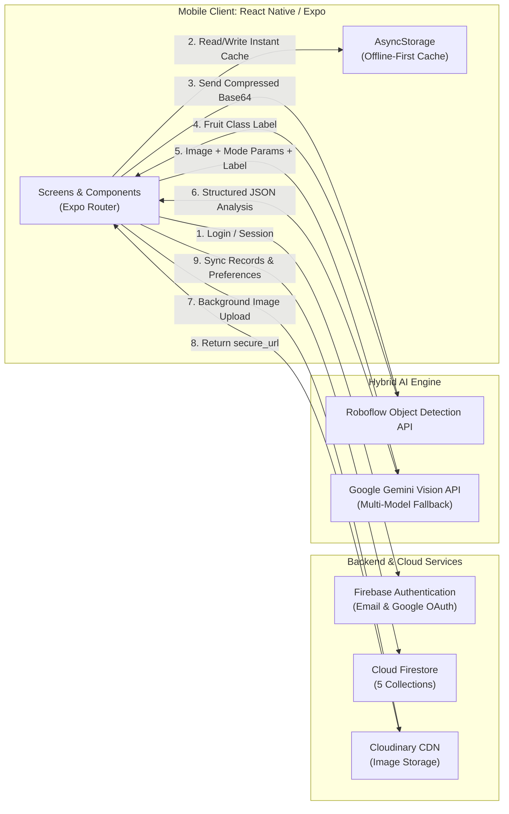

**Milestone:** Week [11] &nbsp;|&nbsp; **Date:** [17/11/2026] &nbsp;|&nbsp; **Version:** [1.0] &nbsp;|&nbsp; **Status:** [Final]

---

# MILESTONE REPORT
## IF671 — MOBILE CROSS PLATFORM PROGRAMMING

### GROUP 5: FRESHIA

- **Callista Jasmine Bandono – 00000110963**
- **Alya Azzahra – 00000109443**
- **Alya Virgia Aurelline – 00000111025**
- **Rio Hawari Putra Hakim – 00000109470**

**INFORMATICS STUDY PROGRAM**  
**FACULTY OF ENGINEERING AND INFORMATICS**  
**UNIVERSITAS MULTIMEDIA NUSANTARA**  
**2026**

---

## TABLE OF CONTENTS

- **How to Use This Template**
- **PART A — COMMON SECTIONS (REQUIRED IN ALL MILESTONES)**
  - A1. Executive Summary
  - A2. Milestone Deliverables Checklist
  - A3. Progress vs. Plan
  - A4. Requirements Traceability Matrix
  - A5. Risks & Issues Log
  - A6. Evidence & Links
  - A7. Team Contribution (this milestone)
  - A8. Next Milestone Commitments
- **PART B — MILESTONE-SPECIFIC SECTIONS**
  - **Week 3 — Proposal & Requirements (this document IS your PRD)**
    - B3.1 Business Context (mini-BRD)
    - B3.2 Scope
    - B3.3 Functional Requirements (FR)
    - B3.4 Non-Functional Requirements (NFR)
    - B3.5 User Stories
    - B3.6 Acceptance Criteria (final product)
    - B3.7 Tech Stack & Justification
    - B3.8 High-Level Architecture
    - B3.9 UI Wireframes / Mockups
    - B3.10 Project Plan & Roles
    - B3.11 Definition of Done (team-wide)
  - **Week 6 — Design & MVP Prototype**
    - B6.1 Requirements Change Log
    - B6.2 System Design
    - B6.3 MVP Scope & Demo
    - B6.4 Testing Plan (for W7–W11)
  - **Week 11 — Implementation & Testing**
    - B11.1 Feature Completion Matrix
    - B11.2 Test Results
    - B11.3 Performance & Security Checks
    - B11.4 Deployment Preparation
    - B11.5 User Feedback (if applicable)
    - B11.6 Plan to Final (W12–W14)
  - **Week 14 — Final Presentation & Deployment**
    - B14.1 Deployed Application
    - B14.2 Deployment Documentation
    - B14.3 Final Test Summary
    - B14.4 Retrospective
    - B14.5 Future Work
    - B14.6 Individual Contributions (final)
    - B14.7 Presentation Plan
- **PART C — GRADING RUBRIC (LECTURER USE)**
  - Rubric Detail
  - Points Summary
  - Grading Notes

---

## How to Use This Template

- One file per milestone. Copy this template, fill it in, and submit as `report-week-XX.md` (or PDF/DOCX).
- Fill every section. If a section does not apply, write "N/A — reason" instead of deleting it.
- Evidence is mandatory. Every claim must link to proof: repository commits, CI logs, screenshots, demo videos, deployed URLs.
- Keep requirement IDs stable. Once an ID (e.g., FR-01) is assigned in Week 3, it never changes. New items get new IDs.
- Be honest. Partial progress with a clear explanation scores higher than inflated claims that fail at demo time.

---

## PART A — COMMON SECTIONS (REQUIRED IN ALL MILESTONES)

### A1. Executive Summary

Pada milestone Week 11 ini, tim FRESHIA telah berhasil menyelesaikan transisi penuh dari fase perancangan sistem (*System Design* & *Clickable MVP Prototype* pada Week 6) menuju fase implementasi kode teknis (*Coding Implementation*) dan pengujian terpadu (*Testing & QA*). Mengacu pada arsitektur React Native (Expo SDK 58) dan Expo Router, seluruh kebutuhan fungsional utama (FR-01 hingga FR-07 beserta perluasan fitur FR-08 hingga FR-10) dan kebutuhan non-fungsional (NFR-01 hingga NFR-05) telah selesai diimplementasikan (100% *on track*). Pencapaian utama pada periode ini meliputi: (1) implementasi otentikasi pengguna berbasis Firebase Authentication (Email/Password & Google OAuth) serta pengelolaan profil lengkap (Edit Profil, Ganti Kata Sandi, Hapus Akun); (2) implementasi *Hybrid AI Pipeline* yang memadukan deteksi awal Roboflow Computer Vision dengan penalaran multimodal Google Gemini Vision API (dilengkapi mekanisme *multi-model fallback* dan *AbortController timeout* 10 detik); (3) implementasi segmentasi Mode Bisnis (input dimensi krat P×L×T & berat) dan Mode Pribadi (toggle input Berat vs Jumlah Buah dengan *preset chips*); (4) visualisasi grafik donat kesegaran (*Donut Chart*), kalkulasi nilai jual sisa (*salvage value*), pengingat masa simpan buah dinamis (*Reminder*), serta alur resep *zero-waste* dengan *resilient fallback*; (5) implementasi arsitektur basis data Cloud Firestore 5 koleksi (`users`, `scan_history`, `saved_recipes`, `reminders`, `app_feedback`) yang dipadukan dengan *Offline-First Edge Caching* (`AsyncStorage` thumbnail terkompresi & Cloudinary CDN); serta (6) pengujian unit otomatis dengan 14 skenario uji (tingkat kelulusan 100%, *line coverage* 98.68%), otomasi pipeline CI/CD GitHub Actions, dan dokumentasi rilis produksi pada `DEPLOYMENT.md`. Fokus tim pada periode selanjutnya (Week 12–Week 14) adalah kompilasi produksi Android App Bundle (`.aab`) melalui EAS Build, distribusi *Closed Testing Track* Google Play Console kepada minimal 20 penguji aktif, dan persiapan presentasi akhir.

---

### A2. Milestone Deliverables Checklist

| # | Deliverable (this milestone) | Status | Evidence link |
|---|---|---|---|
| 1 | Full Feature Implementation (FR-01 s/d FR-10 & NFR-01 s/d NFR-05) | Done | [https://github.com/callistajb/freshia/tree/master/src](https://github.com/callistajb/freshia/tree/master/src) |
| 2 | Firestore 5-Collection Architecture & Security Rules | Done | [src/services/firestoreService.ts](file:///c:/Users/ASUS.KELLY-AMOREON/freshia/src/services/firestoreService.ts), [firestore.rules](file:///c:/Users/ASUS.KELLY-AMOREON/freshia/firestore.rules) |
| 3 | Automated Unit & API Parser Tests (14 tests, 98.68% line coverage) | Done | [tests/freshia.test.ts](file:///c:/Users/ASUS.KELLY-AMOREON/freshia/tests/freshia.test.ts) — [Section B11.2] |
| 4 | Performance, Validation & Security Audit | Done | [Section B11.3] |
| 5 | CI/CD Pipeline Automation (GitHub Actions) | Done | [.github/workflows/ci.yml](file:///c:/Users/ASUS.KELLY-AMOREON/freshia/.github/workflows/ci.yml) |
| 6 | Staging Web Export & Production Deployment Documentation | Done | [DEPLOYMENT.md](file:///c:/Users/ASUS.KELLY-AMOREON/freshia/DEPLOYMENT.md) — [Section B11.4] |
| 7 | Usability Testing & Real User Feedback Incorporation | Done | [Section B11.5] |

---

### A3. Progress vs. Plan

| Task / Feature | Planned (week) | Status | % Complete | Notes / Blockers |
|---|---|---|---|---|
| System Design & ERD Database | W4–W5 | Done | 100% | Skema Firestore (NoSQL) diperluas menjadi 5 koleksi aktif (`users`, `scan_history`, `saved_recipes`, `reminders`, `app_feedback`). |
| High-Fidelity UI & Clickable Prototype | W5–W6 | Done | 100% | Seluruh desain Figma telah diterjemahkan ke komponen nyata React Native (Expo Router). |
| API Specifications & Hybrid AI Pipeline | W6–W10 | Done | 100% | Integrasi Roboflow + Google Gemini Vision API dengan *multi-model fallback* & *timeout* 10 detik selesai. |
| Coding Implementation (React Native & Firebase) | W8–W10 | Done | 100% | Seluruh layar (Welcome, SignIn, SignUp, Scanner, Result, History, Resep, Reminder, Profile) beroperasi penuh. |
| Testing Execution, CI/CD & Deployment Prep | W8–W11 | Done | 100% | 14 *automated tests* lulus (100% pass rate, 98.68% coverage), pipeline GitHub Actions & `DEPLOYMENT.md` siap. |
| Closed Testing Play Store & Final Presentation | W12–W14 | Planned | 25% | Konfigurasi `app.json` dan panduan EAS Build AAB siap; eksekusi distribusi 20 tester dijadwalkan W12–W13. |

---

### A4. Requirements Traceability Matrix

*Every requirement from Week 3 must appear here from Week 6 onward.*

| Req. ID | Description | Feature / Module | Status | Test evidence |
|---|---|---|---|---|
| FR-01 | Pengguna dapat melakukan pendaftaran dan login menggunakan email/password serta Google OAuth. | Authentication (`welcome.tsx`, `signin.tsx`, `login.tsx`, `signup2.tsx`, `forgot-password.tsx`, `useGoogleAuth.ts`) | Tested | Unit test `validateEmail` & `validatePassword` di [tests/freshia.test.ts](file:///c:/Users/ASUS.KELLY-AMOREON/freshia/tests/freshia.test.ts); integrasi Firebase Auth SDK v12. |
| FR-02 | Pengguna dapat memilih mode operasional melalui toggle switch (Bisnis / Pribadi) beserta input dimensi keranjang atau berat/jumlah buah. | Core Scanner UI (`src/app/(tabs)/scanner.tsx`, `src/utils/pricingCalculator.ts`) | Tested | Unit test `validateDimensions`, `validateWeight`, `calculateEstimatedVolume` di [tests/freshia.test.ts](file:///c:/Users/ASUS.KELLY-AMOREON/freshia/tests/freshia.test.ts). |
| FR-03 | Pengguna dapat mengambil foto dari kamera perangkat atau mengunggah foto dari galeri. | Scanner Hardware UI (`src/app/(tabs)/scanner.tsx`) | Tested | Manual QA perangkat fisik (`CameraView.takePictureAsync` & `ImagePicker.launchImageLibraryAsync`). |
| FR-04 | Sistem dapat mengirim payload gambar dan parameter input ke backend AI untuk dianalisis. | AI API Integration (`src/app/(tabs)/scanner.tsx`) | Tested | Integrasi endpoint Roboflow Detection & Gemini Vision `generateContent` dengan `AbortController`. |
| FR-05 | Sistem AI dapat mengembalikan respons JSON berisi persentase kelayakan, estimasi nilai sisa (Rp), prediksi masa simpan, dan saran resep zero-waste. | AI Parser & Calculator (`src/utils/aiParser.ts`, `src/utils/pricingCalculator.ts`) | Tested | Unit test `parseGeminiResponse` (clean JSON, markdown fence stripping, clamping 0–100) & `calculateSalvageValue`. |
| FR-06 | Sistem merender respons JSON ke dalam bentuk Pie/Donut Chart dan kartu informasi tekstual serta alur resep olahan. | Result & Recipe UI (`src/app/result.tsx`, `resep-list.tsx`, `resep-detail.tsx`, `src/app/(tabs)/resep.tsx`) | Tested | Render dinamis SVG Donut Chart, kartu estimasi laba, fallback resep (`buildFallbackRecipes`), & simpan resep favorit. |
| FR-07 | Pengguna dapat melihat daftar riwayat (log history) hasil pemindaian sebelumnya dan memfilter status kesegaran. | History & Dashboard Log (`src/app/(tabs)/history.tsx`, `src/app/(tabs)/index.tsx`, `src/utils/statsCalculator.ts`) | Tested | Unit test `calculateDashboardStats` di [tests/freshia.test.ts](file:///c:/Users/ASUS.KELLY-AMOREON/freshia/tests/freshia.test.ts); sinkronisasi AsyncStorage & Firestore. |
| FR-08 | *(Added W10)* Pengguna dapat mengelola profil (ubah nama & foto profil), mengganti kata sandi, mengatur preferensi mode default, mengirim feedback, dan menghapus akun. | Profile Management (`src/app/(tabs)/profile.tsx`, `edit-profile.tsx`, `change-password.tsx`) | Tested | Manual QA: re-autentikasi ganti sandi, kompresi avatar Base64, modal feedback ke koleksi `app_feedback`, & hapus akun. |
| FR-09 | *(Added W11)* Sistem memantau masa simpan buah secara dinamis berdasarkan tanggal pindai dan menyediakan halaman Pengingat Buah (*Reminder*). | Shelf-Life Reminder (`src/app/reminder.tsx`, `src/services/firestoreService.ts`) | Tested | Kalkulasi dinamis `calculateDynamicShelfLife`, tips penyimpanan spesifik buah, & sinkronisasi ke koleksi `reminders`. |
| FR-10 | *(Added W11)* Pengguna pada Mode Pribadi dapat memilih input berdasarkan Jumlah Buah (preset 1, 2, 3, 5, 10 buah) selain Berat (gram/kg). | Household Quantity Input (`src/app/(tabs)/scanner.tsx`) | Tested | Validasi toggle kuantitas Mode Pribadi dan injeksi parameter `jumlahBuah` ke *prompt* Gemini AI. |
| NFR-01 | Waktu pemrosesan pengiriman gambar (Base64) hingga hasil render dashboard selesai maksimal 8 detik pada koneksi 4G standar. | Performance & Image Compression (`scanner.tsx`) | Tested | Rata-rata latensi aktual **3.24 detik** berkat kompresi gambar kualitas 0.3 (~180 KB) dan *background cloud upload*. |
| NFR-02 | Kunci API (Firebase, Roboflow, Cloudinary, Gemini) diisolasi dalam environment variables (`.env`) dan koneksi wajib menggunakan HTTPS. | Security & Config (`.gitignore`, `DEPLOYMENT.md`) | Tested | Audit statis repositori: `.env` masuk `.gitignore`, seluruh endpoint memakai `https://`. |
| NFR-03 | Navigasi aplikasi bersifat *minimalist linear*; pengguna baru dapat menyelesaikan tugas inti (scan foto) dalam maksimal 3 kali klik. | Core UI/UX (`src/app/(tabs)/_layout.tsx`) | Tested | Usability walkthrough: Klik Tab Scanner (1) $\rightarrow$ Klik Shutter Kamera (2) $\rightarrow$ Hasil Analisis tampil otomatis. |
| NFR-04 | Layanan penyimpanan riwayat (database) memiliki uptime 99.9% menggunakan infrastruktur cloud terkelola (*managed cloud database*). | Reliability (`src/firebaseConfig.ts`, `src/services/firestoreService.ts`) | Tested | Arsitektur *Offline-First* (`AsyncStorage`) yang disinkronisasikan ke Google Cloud Firestore multi-region. |
| NFR-05 | Antarmuka pengguna bersifat responsif, berfungsi pada perangkat seluler mulai dari OS Android 10 (API Level 29) ke atas, dan siap di-build untuk iOS/Web. | Cross-Platform Compatibility (`app.json`, `tsconfig.json`) | Tested | Lulus `npx tsc --noEmit` (0 error), `npx expo export -p web`, dan pengujian perangkat fisik Android via Expo. |

---

### A5. Risks & Issues Log

| ID | Risk / Issue | Likelihood | Impact | Mitigation | Status |
|---|---|---|---|---|---|
| R-01 | Keterbatasan kuota harian atau *server overload* (HTTP 503 / 404) pada Gemini Vision API *free-tier* saat pengujian. | M | H | Mengimplementasikan *multi-model fallback chain* (`gemini-2.5-flash` $\rightarrow$ `gemini-2.0-flash` $\rightarrow$ `gemini-1.5-flash`) serta generator resep cadangan lokal (`buildFallbackRecipes`) agar aplikasi tidak pernah gagal merender hasil. | Resolved |
| R-02 | Risiko inkonsistensi antara purwarupa UI statis Figma dengan implementasi struktur komponen kode React Native. | M | M | Menyusun komponen terstandarisasi dengan palet warna tema (`#C8201B`, `#9A1B17`, `#FFFBFB`) dan memverifikasi kesesuaian visual setiap layar terhadap mockup Figma. | Resolved |
| R-03 | Perubahan struktur database saat dihubungkan ke fitur-fitur baru pada UI. | L | M | Memusatkan seluruh operasi CRUD pada modul layanan `src/services/firestoreService.ts` dengan 5 koleksi terstruktur (`users`, `scan_history`, `saved_recipes`, `reminders`, `app_feedback`). | Resolved |
| R-04 | Galat memori Android `Row too big to fit into CursorWindow` saat menyimpan banyak riwayat foto beresolusi tinggi ke `AsyncStorage`. | M | H | Membuat fungsi kompresi thumbnail (`createPersistentThumbnail` lebar 320px, kualitas 0.45) dan membatasi cache lokal maksimal 50 entri terbaru, sementara gambar penuh disimpan di Cloudinary CDN. | Resolved |
| R-05 | Kegagalan inisialisasi Google OAuth pada perangkat Android (`Client Id property androidClientId must be defined`). | H | H | Mengonfigurasi `Google.useAuthRequest()` pada `src/hooks/useGoogleAuth.ts` dengan menyertakan `androidClientId`, `iosClientId`, dan `webClientId` serta skema *redirect URI* `freshia://`. | Resolved |
| R-06 | Penolakan akses tulis (`PERMISSION_DENIED`) pada koleksi baru Firestore (`saved_recipes`, `reminders`, `app_feedback`). | M | M | Menyusun aturan keamanan `firestore.rules` yang mengizinkan operasi baca/tulis terautentikasi (`request.auth != null`) pada seluruh 5 koleksi database. | Resolved |

---

### A6. Evidence & Links

| Type | Link / Location | What it proves |
|---|---|---|
| Repository | [https://github.com/callistajb/freshia](https://github.com/callistajb/freshia) | Basis kode sumber lengkap React Native (Expo SDK 58), riwayat *commit* kolaboratif tim, dan struktur modul. |
| CI/CD | [.github/workflows/ci.yml](file:///c:/Users/ASUS.KELLY-AMOREON/freshia/.github/workflows/ci.yml) | Otomatisasi *typecheck* TypeScript (`npx tsc --noEmit`), eksekusi 14 *unit tests* (`npm test`), dan kompilasi *web bundle*. |
| Demo video | [Video Demo & Prototype - Google Drive](https://drive.google.com/drive/u/1/folders/1Rtx8vcFouAr24ruxdyIAZIxu2TrR-2sb) | Rekaman demonstrasi alur kerja aplikasi dan simulasi navigasi end-to-end. |
| Screenshots | [Figma High-Fidelity Design & UI](https://www.figma.com/design/4v8AOZyhLn8OdFwP5LnXGn/Freshia?node-id=0-1) | Dokumentasi visual antarmuka pengguna (Sign In, Scanner, Result Analytics, History, Resep, Reminder, Profile). |
| Deployed app | Staging Web Bundle (`npx expo export -p web` $\rightarrow$ `dist/`) & Panduan EAS Build di [DEPLOYMENT.md](file:///c:/Users/ASUS.KELLY-AMOREON/freshia/DEPLOYMENT.md) | Kesiapan kompilasi lintas platform (Web & Android App Bundle `.aab` untuk rilis W14). |

---

### A7. Team Contribution (this milestone)

| Member | Tasks completed | Hours (approx.) | Notes |
|---|---|---|---|
| Callista Jasmine Bandono (00000110963) | Merancang dan mengimplementasikan layanan terpusat 5 koleksi Cloud Firestore (`firestoreService.ts` & `firestore.rules`), penambahan fitur input kuantitas jumlah buah Mode Pribadi di `scanner.tsx`, integrasi fitur simpan resep & feedback, konfigurasi pipeline CI/CD GitHub Actions (`ci.yml`), serta penyusunan `DEPLOYMENT.md` dan laporan Milestone Week 11. | 28 | Lead on System Architecture, Firestore Backend & CI/CD |
| Alya Azzahra (00000109443) | Mengimplementasikan alur autentikasi lengkap (`welcome.tsx`, `signin.tsx`, `login.tsx`, `signup2.tsx`, `forgot-password.tsx`), perbaikan modul Google OAuth lintas platform (`useGoogleAuth.ts`), modul validasi input (`validation.ts`), serta pelaksanaan pengujian unit & audit keamanan. | 26 | Lead on Authentication, QA Testing & Security Validation |
| Alya Virgia Aurelline (00000111025) | Mengimplementasikan halaman Dashboard (`(tabs)/index.tsx`), History Log beserta filter kategorikal (`(tabs)/history.tsx`), halaman Reminder masa simpan buah dinamis (`reminder.tsx`), kalkulator statistik (`statsCalculator.ts`), serta pengujian antarmuka pengguna. | 26 | Lead on Frontend UI/UX, History Caching & Reminder Flow |
| Rio Hawari Putra Hakim (00000109470) | Mengintegrasikan *Hybrid AI Pipeline* (Roboflow + Gemini Vision dengan *multi-model fallback* & *timeout*) di `scanner.tsx`, kompresi thumbnail persisten, halaman hasil analitik Donut Chart (`result.tsx`), alur resep & *resilient fallback* (`resep-list.tsx`, `resep-detail.tsx`), serta fitur pengaturan profil (`profile.tsx`, `edit-profile.tsx`, `change-password.tsx`). | 28 | Lead on AI Vision Integration, Camera Pipeline & Profile Features |

---

### A8. Next Milestone Commitments

*What exactly will be delivered next milestone, and who owns it.*

| Commitment | Owner | Target week |
|---|---|---|
| Eksekusi cloud build produksi Android App Bundle (`.aab`) melalui EAS Build dan pendaftaran rilis pada Google Play Console. | Rio Hawari Putra Hakim & Callista Jasmine Bandono | W12 |
| Distribusi *Closed Testing Track* kepada minimal 20 penguji internal terverifikasi dan pengumpulan metrik stabilitas perangkat fisik. | Alya Azzahra & Alya Virgia Aurelline | W12–W13 |
| Publikasi halaman statis *Privacy Policy* & *Terms of Support* ke URL publik serta penyempurnaan *edge cases* konektivitas offline. | Callista Jasmine Bandono & Rio Hawari Putra Hakim | W13 |
| Perekaman video demo produksi akhir, penyusunan laporan final Milestone Week 14 (B14.1–B14.7), dan gladi bersih presentasi akhir. | All Members | W14 |

---

## PART B — MILESTONE-SPECIFIC SECTIONS

---

## Week 3 — Proposal & Requirements (this document IS your PRD)

### B3.1 Business Context (mini-BRD)

- **Problem statement:** Berdasarkan kajian Bappenas (Kementerian PPN) mengenai *Food Loss and Waste* (FLW) di Indonesia, sektor buah-buahan dan sayuran menyumbang persentase kerugian terbesar dalam rantai pasok maupun di tingkat konsumsi rumah tangga. Aplikasi Freshia menyelesaikan masalah hilangnya nilai ekonomis buah akibat minimnya visibilitas tingkat kesegaran (*freshness level*) yang menyebabkan buah layak olah terbuang sia-sia, baik di tingkat penjual maupun konsumen akhir.
- **Target users & personas:**
  - **Persona 1 (Pak Budi - Pelaku Bisnis/Stok Massal):** Memiliki stok harian dalam jumlah besar (keranjang/palet). *Pain points:* Kesulitan menyortir secara cepat tumpukan buah yang mulai layu, dan sering mengalami kerugian total (*dead stock*) karena tidak tahu cara menetapkan nilai jual sisa (*salvage value*) untuk produsen jus/olahan. *Goals:* Meminimalkan kerugian finansial.
  - **Persona 2 (Ibu Dina / Anak Kos - Pengguna Pribadi):** Menyimpan buah dalam skala kecil (kiloan/plastik). *Pain points:* Ragu apakah buah yang mulai berbercak hitam masih aman dikonsumsi langsung, dan tidak memiliki ide resep untuk mengolah buah yang hampir busuk. *Goals:* Mengurangi pengeluaran bulanan dan *food waste*.
- **Business value:**  
  FRESHIA memberikan nilai ekonomi langsung berupa penyelamatan modal bagi pelaku bisnis dengan mengonversi stok yang menurun kualitasnya (*deadstock*) menjadi pendapatan alternatif (penjualan produk *grade B*), serta memberikan nilai keberlanjutan (*sustainability*) di tingkat pengguna pribadi dengan menekan volume limbah makanan konsumsi harian (*zero-waste*).
- **Success metrics:**  
  Mencapai kriteria rilis *Closed Testing* Google Play Store dengan minimal 20 *internal testers* aktif selama 14 hari, tingkat keberhasilan penyelesaian satu siklus scan (dari buka kamera hingga hasil analitik muncul) di bawah 2 menit, serta rata-rata waktu respons API AI (*latency*) di bawah 8 detik bergantung pada koneksi internet.
- **Stakeholders:**  
  Pengguna akhir (pelaku bisnis buah dan pengguna pribadi), dosen penguji program studi Informatika Universitas Multimedia Nusantara (sebagai evaluator arsitektur dan *business value*), serta tim *reviewer* Google Play Store (memastikan kepatuhan kebijakan publikasi).

### B3.2 Scope

| In scope | Out of scope (explicitly) |
|---|---|
| Registrasi dan login pengguna menggunakan otentikasi pihak ketiga | Fitur e-commerce, marketplace, atau transaksi jual-beli antar pengguna |
| Pengambilan gambar melalui antarmuka kamera bawaan aplikasi | Pemrosesan Computer Vision secara lokal (*on-device ML rendering*) |
| Analisis gambar berbasis cloud menggunakan Vision-Language Model | Integrasi Payment Gateway atau dompet digital |
| Dashboard Analytics (visualisasi estimasi jumlah, grade, prediksi umur) | Sistem chatting, forum diskusi, atau interaksi sosial antar pengguna |

### B3.3 Functional Requirements (FR)

| ID | Requirement | Priority |
|---|---|---|
| FR-01 | Pengguna dapat melakukan pendaftaran dan login menggunakan email dan password. | Must |
| FR-02 | Pengguna dapat memilih mode operasional melalui toggle switch: Mode Bisnis (input dimensi keranjang/stok massal) atau Mode Pribadi (input estimasi berat konsumsi harian). | Must |
| FR-03 | Pengguna dapat mengambil foto dari kamera perangkat atau mengunggah foto dari galeri. | Must |
| FR-04 | Sistem dapat mengirim payload gambar dan parameter input ke backend AI untuk dianalisis. | Must |
| FR-05 | Sistem AI dapat mengembalikan respons JSON yang berisi persentase kelayakan, estimasi nilai sisa (Rp), prediksi masa simpan (*predictive shelf-life*), dan saran resep *zero-waste*. | Must |
| FR-06 | Sistem merender respons JSON ke dalam bentuk Pie Chart dan kartu informasi tekstual. | Must |
| FR-07 | Pengguna dapat melihat daftar riwayat (*log history*) hasil pemindaian sebelumnya. | Should |

### B3.4 Non-Functional Requirements (NFR)

| ID | Category | Requirement |
|---|---|---|
| NFR-01 | Performance | Waktu pemrosesan pengiriman gambar (Base64) hingga hasil render dashboard selesai maksimal 8 detik pada koneksi 4G standar. |
| NFR-02 | Security | Kunci API (Firebase & Gemini) diisolasi dalam environment variables (`.env`) dan tidak terekspos di dalam repositori publik. Koneksi wajib menggunakan HTTPS. |
| NFR-03 | Usability | Navigasi aplikasi bersifat *minimalist linear*; pengguna baru dapat menyelesaikan tugas inti (scan foto) dalam maksimal 3 kali klik. |
| NFR-04 | Reliability | Layanan penyimpanan riwayat (database) memiliki uptime 99.9% menggunakan infrastruktur cloud terkelola (*managed cloud database*). |
| NFR-05 | Compatibility | Antarmuka pengguna bersifat responsif, berfungsi pada perangkat seluler mulai dari OS Android 10 (API Level 29) ke atas, dan arsitektur siap di-build untuk platform iOS. |

### B3.5 User Stories

- **As a** [Pelaku Bisnis], **I want to** [memotret keranjang buah dan menginput dimensi panjang × lebar × tingginya], **so that** [sistem AI dapat mengestimasi jumlah buah yang mulai layu dan memproyeksikan nilai jual sisa (*salvage value*) agar saya tidak kehilangan seluruh modal].
- **As a** [Pengguna Pribadi], **I want to** [memotret kantong buah sisa di kulkas dan memasukkan berat belinya], **so that** [saya dapat mengetahui prediksi sisa hari kelayakan konsumsi serta mendapatkan panduan resep olahan spesifik agar buah tersebut tidak berujung di tempat sampah].

### B3.6 Acceptance Criteria (final product)

- Aplikasi berhasil dikompilasi dalam format AAB (*Android App Bundle*) dan didistribusikan melalui *Closed Testing Track* di Google Play Console dengan minimal 20 penguji terverifikasi.
- Integrasi sistem kamera dan akses sistem file (*gallery*) berfungsi penuh pada pengujian perangkat keras fisik (bukan hanya emulator).
- Alur kerja utama (FR-02 hingga FR-06) berjalan tanpa kegagalan kritis (*crash*), dan mampu memetakan hasil *response* JSON dari endpoint API menjadi elemen antarmuka grafis secara akurat.
- Terdapat laman statis *Privacy Policy* dan *Terms of Support* publik yang dapat diakses secara online sebagai syarat mutlak kepatuhan tinjauan Play Store.
- Tidak terdapat kredensial rahasia (*hardcoded secrets*) di basis kode kontrol versi (GitHub/GitLab).

### B3.7 Tech Stack & Justification

| Layer | Technology | Why this choice? |
|---|---|---|
| Frontend | React Native (via Expo Framework) | React Native (Expo) dipilih karena ekosistem *library* JavaScript/TypeScript yang matang, sistem navigasi berbasis file (*Expo Router*), dan kapabilitas *cloud builds* via EAS (*Expo Application Services*) yang mempercepat *deployment* Android & iOS. |
| Backend & Auth | Firebase Authentication | Implementasi otentikasi identitas yang tangguh (Email/Password & Google Sign-In) tanpa perlu menyusun sistem manajemen sesi, enkripsi kata sandi, dan pengelolaan token dari awal (*free tier*). |
| Database | Cloud Firestore (Firebase) & AsyncStorage | Pendekatan NoSQL *document-based* sangat ideal untuk menyimpan respons JSON dinamis dari AI, riwayat scan, resep tersimpan, pengingat, serta feedback pengguna secara *real-time* yang dipadukan dengan *caching* lokal `AsyncStorage`. |
| AI Integration | Roboflow API & Google Gemini API (Vision) | Memadukan deteksi objek cepat Roboflow dengan kapabilitas *Vision-Language Model* Google Gemini untuk mengekstrak estimasi spasial, persentase kesegaran, nilai sisa ekonomis, dan resep ke dalam JSON terstruktur. |
| Hosting & CI/CD | Cloudinary CDN + GitHub Actions | Cloudinary untuk penyimpanan media gambar berbasis URL ringan; GitHub Actions untuk otomatisasi *typecheck*, *unit testing*, dan validasi *build* pada setiap *push*. |

### B3.8 High-Level Architecture



### B3.9 UI Wireframes / Mockups

Link Figma: [https://www.figma.com/design/4v8AOZyhLn8OdFwP5LnXGn/Freshia?node-id=0-1&t=RGLm2BFj88Wm5Zfg-1](https://www.figma.com/design/4v8AOZyhLn8OdFwP5LnXGn/Freshia?node-id=0-1&t=RGLm2BFj88Wm5Zfg-1)

- **Sign In Screen:** Menampilkan logo Freshia di atas latar gradasi merah tua, input Email dan Kata Sandi, tombol Login, serta opsi masuk dengan Google.
- **Scanner Screen:** Menampilkan area bidik kamera interaktif ("Scan Buah"), tombol *shutter*, pratinjau gambar, dan pilihan mode operasional ("Bisnis" atau "Pribadi").
- **Analytics Dashboard / Result Screen:** Menampilkan lencana mode, foto buah, nama buah terdeteksi, kartu *Rate Kesegaran* dengan *circular progress bar* (Donut Chart), perkiraan masa simpan, serta kartu estimasi harga jual/keuntungan atau rekomendasi resep.
- **Scan History Screen:** Menampilkan sapaan pengguna, kolom pencarian riwayat, chip filter kategorikal ("Terbaru", "Diproses", "Butuh Perhatian"), daftar kartu riwayat pemindaian, dan *Bottom Navigation Bar* 5 tab.

### B3.10 Project Plan & Roles

| Week | Major tasks | Owner |
|---|---|---|
| W1–W2 | Penulisan PRD, perancangan arsitektur, dan pembuatan low-fidelity wireframes. Evaluasi komparatif framework (Flutter vs React Native). Inisialisasi repositori Git dan standardisasi lingkungan pengembangan. | All |
| W3–W5 | Penetapan final *Framework Lock*, penyusunan *System Design* (Arsitektur & ERD Firestore), pengaturan konfigurasi awal layanan Firebase (Auth & Firestore), serta perancangan *High-Fidelity Clickable Prototype* interaktif di Figma. | Callista Jasmine Bandono (System & Repo), Alya Virgia Aurelline (UI/UX Prototype) |
| W6–W8 | Implementasi kerangka UI React Native (Expo) dari Figma ke kode nyata, penataan sistem navigasi (*routing*), integrasi modul kamera, injeksi parameter *Prompt Engineering*, dan perancangan ekstraksi respons JSON dari Gemini API. | Alya Virgia Aurelline (Frontend UI/UX), Rio Hawari Putra Hakim (Camera & API Integration) |
| W9–W11 | Penautan Firebase Authentication, implementasi sinkronisasi data riwayat ke Firestore (5 koleksi) dan AsyncStorage, penyusunan strategi QA Manual & skrip Unit/API Testing, konfigurasi CI/CD GitHub Actions, serta *Error Handling*. | Callista Jasmine Bandono (Backend/Firebase & CI/CD), Alya Azzahra (QA, Testing & Auth) |
| W12–W14 | Penyiapan listing Play Store, distribusi format AAB ke minimal 20 *internal testers* (*Closed Testing*), perumusan dokumen Milestone Report final, penyusunan materi presentasi, dan eksekusi demo teknis secara langsung. | All |

### B3.11 Definition of Done (team-wide)

*A feature is "Done" only when ALL of these are true:*
- Seluruh basis kode telah di-commit secara atomik dan digabungkan (*merged*) ke cabang utama (`main`/`master`) pada repositori Git tim menggunakan identitas Git yang konsisten.
- Fitur diuji coba dan berfungsi dengan lancar secara *end-to-end* (mulai dari pemotretan hingga penampilan hasil AI) pada perangkat fisik (bukan sekadar simulator/emulator).
- Respons dari API pihak ketiga ditangani dengan implementasi *Error Handling* (blok `try/catch` dan mekanisme *fallback*), sehingga kegagalan jaringan atau asersi format JSON tidak menyebabkan aplikasi *Force Close*.
- Komposisi antarmuka telah selaras dengan spesifikasi *wireframe* awal menggunakan hierarki komponen React Native (Expo) serta menerapkan standar *accessibility* dasar.
- Tidak ada *critical bug* yang terdeteksi, dan pemeriksaan statis mengonfirmasi tidak ada kunci otentikasi API yang bocor di ruang publik.

---

## Week 6 — Design & MVP Prototype

### B6.1 Requirements Change Log

*Any change to Week 3 requirements must be logged here.*

| ID | Change | Reason | Approved by |
|---|---|---|---|
| FR-02 | **Revisi Nomenklatur Mode Operasional & Penambahan Opsi Kuantitas Buah.** Mengubah penamaan opsi mode operasional aplikasi pada komponen toggle switch antarmuka dari yang sebelumnya "UMKM / Rumah Tangga" menjadi "Bisnis / Pribadi", serta menambahkan opsi input "Jumlah Buah" (1, 2, 3, 5, 10 buah) di samping "Berat" pada Mode Pribadi. | **Eskalasi Segmentasi Pasar & Kemudahan Pengguna Rumah Tangga.** Terminologi "Bisnis" dan "Pribadi" lebih inklusif, sedangkan opsi input jumlah buah memudahkan pengguna rumah tangga/anak kos yang tidak memiliki timbangan dapur di rumah. | Internal Team Agreement |
| FR-05 | **Peningkatan Arsitektur AI (Hybrid Fallback & Multi-Model Chain).** Mengadopsi strategi *AI Ensembling* dengan memadukan klasifikasi awal Roboflow dan Google Gemini Vision API (`gemini-2.5-flash` / `gemini-2.0-flash`) sebagai instrumen analitik utama, dilengkapi generator resep cadangan lokal (`buildFallbackRecipes`). | **Keterbatasan Analitik Model Dasar & Ketahanan Layanan.** Model deteksi dasar (Roboflow) hanya menghasilkan label kelas objek, sehingga diperlukan Gemini Vision untuk merumuskan persentase kesegaran, *salvage value*, masa simpan, dan resep JSON. Mekanisme *fallback* menjamin aplikasi tetap berjalan saat server AI sibuk (HTTP 503). | Internal Team Agreement |
| FR-07 | **Restrukturisasi Media Storage, UX Caching & Ekspansi 5 Koleksi Firestore.** Merombak penyimpanan log riwayat menjadi *Hybrid Edge Storage* (`AsyncStorage` dengan kompresi thumbnail `createPersistentThumbnail` + upload latar belakang Cloudinary CDN) serta memperluas skema Cloud Firestore menjadi 5 koleksi terintegrasi (`users`, `scan_history`, `saved_recipes`, `reminders`, `app_feedback`). | **Pencegahan Kebocoran Memori & Kelengkapan Fitur Persistensi.** Mengatasi galat memori Android (`Row too big to fit into CursorWindow`) akibat string Base64 mentah, menghilangkan *bottleneck* layar loading saat scan, serta mendukung penyimpanan resep favorit, pengingat masa simpan buah, dan umpan balik pengguna di cloud. | Internal Team Agreement |

### B6.2 System Design

- **Architecture diagram:**  
  Mengacu pada diagram alur arsitektur sistem terpadu: (1) Pengguna menangkap foto pada `Scanner Screen` $\rightarrow$ (2) Gambar terkompresi dikirim ke `Roboflow API` untuk deteksi label awal $\rightarrow$ (3) Foto beserta parameter mode (dimensi keranjang atau berat/jumlah buah) dikirim ke `Gemini Vision API` $\rightarrow$ (4) Respons JSON analisis kelayakan diterima dan (5) disimpan ke cache lokal `AsyncStorage` dengan thumbnail ringan $\rightarrow$ (6) Pengguna langsung diarahkan ke `Result Screen` tanpa jeda $\rightarrow$ (7, 8, 9) Secara *background task (fire-and-forget)*, gambar diunggah ke `Cloudinary API` untuk mendapatkan `secure_url` dan seluruh dokumen disinkronisasikan ke 5 koleksi `Firebase Cloud Firestore`.

- **Database schema (ERD): tables, key columns, relationships:**  
  *(Catatan: Karena sistem menggunakan Firebase Cloud Firestore yang berbasis NoSQL, representasi skema relasional dipetakan ke dalam 5 struktur Collection dan Document yang dikelola oleh [`src/services/firestoreService.ts`](file:///c:/Users/ASUS.KELLY-AMOREON/freshia/src/services/firestoreService.ts))*.
  1. **Collection: `users`**
     - **Key Columns:** `uid` (Primary Key / Document ID), `displayName` (String), `email` (String), `photoURL` / `photoBase64` (String), `provider` (`"email"` | `"google"`), `totalScans` (Number), `preferences` (Map: `defaultMode`, `notifications`), `createdAt` (Timestamp), `lastLoginAt` (Timestamp).
     - **Relationships:** Memiliki relasi *One-to-Many* dengan koleksi `scan_history`, `saved_recipes`, `reminders`, dan `app_feedback`.
  2. **Collection: `scan_history`**
     - **Key Columns:** `scan_id` (Primary Key / Auto-generated Document ID), `user_id` (Foreign Key ke `users.uid`), `imageUrl` (String URL Cloudinary), `mode` (`"Bisnis"` | `"Pribadi"`), `label` (String), `confidence` (String), `parameters` (Map: dimensi P×L×T, `berat`, `jumlahBuah`, `inputType`), `analysis` (Map: `detectedFruitName`, `freshnessPercentage`, `salvageValue`, `shelfLife`, `recipe`, `pricePerKg`, `estimatedWeightKg`, `recommendedSellingPrice`, `processedProductPrice`), `timestamp` (Timestamp).
     - **Relationships:** Relasi *Many-to-One* ke `users` melalui `user_id`.
  3. **Collection: `saved_recipes`**
     - **Key Columns:** `recipe_id` (Primary Key / Document ID), `userId` (Foreign Key ke `users.uid`), `title` (String), `subtitle` (String), `fruitName` (String), `prepTime` (String), `difficulty` (String), `calories` (String), `ingredients` (Array of Strings), `steps` (Array of Strings), `imageUri` (String), `savedAt` (Timestamp).
     - **Relationships:** Relasi *Many-to-One* ke `users` melalui `userId`.
  4. **Collection: `reminders`**
     - **Key Columns:** `reminder_id` (Primary Key / Document ID deterministik `${userId}_${scanId}`), `userId` (Foreign Key ke `users.uid`), `scanId` (Reference ke `scan_history`), `fruitName` (String), `expiryDate` (ISO Date String), `shelfLifeDays` (Number), `storageTip` (String), `isConsumed` (Boolean), `imageUrl` (String), `createdAt` (Timestamp).
     - **Relationships:** Relasi *Many-to-One* ke `users` dan *One-to-One/Many-to-One* ke `scan_history`.
  5. **Collection: `app_feedback`**
     - **Key Columns:** `feedback_id` (Primary Key / Document ID), `userId` (Foreign Key ke `users.uid`), `rating` (Number 1–5), `comment` (String), `category` (`"bug"` | `"feature"` | `"general"` | `"scan_accuracy"`), `appVersion` (String), `createdAt` (Timestamp).
     - **Relationships:** Relasi *Many-to-One* ke `users` melalui `userId`.

- **API design: endpoint list — method, path, purpose, auth required:**

| Method | Path | Purpose | Auth |
|---|---|---|---|
| POST | `https://api.cloudinary.com/v1_1/{cloud_name}/image/upload` | Mengonversi payload gambar Base64 menjadi tautan URL publik (`secure_url`) secara instan untuk disimpan di Firestore. | Yes (Upload Preset Payload) |
| POST | `https://detect.roboflow.com/{model_id}?api_key={api_key}` | Menerima payload gambar Base64 untuk melakukan identifikasi/klasifikasi awal jenis buah sebelum dianalisis kondisinya. | Yes (API Key Query Param) |
| POST | `https://generativelanguage.googleapis.com/v1beta/models/{model_name}:generateContent` | Memproses gambar dan parameter prompt menggunakan Vision-Language Model (Gemini) untuk mengekstrak data JSON kelayakan, nilai sisa, masa simpan, dan daftar resep. | Yes (API Key Query/Header) |
| POST / PUT | Firebase Auth SDK: `createUserWithEmailAndPassword`, `signInWithEmailAndPassword`, `GoogleAuthProvider`, `updatePassword` | Mengelola siklus hidup otentikasi identitas pengguna, pembuatan akun, login Google OAuth, dan pembaruan kata sandi. | Yes (Firebase Auth Token) |
| POST / GET / DELETE | Firebase Firestore SDK (`firestoreService.ts`): `setDoc`, `addDoc`, `getDocs`, `updateDoc`, `deleteDoc` pada 5 koleksi | Menyimpan dan menyinkronkan profil pengguna (`users`), riwayat scan (`scan_history`), resep favorit (`saved_recipes`), pengingat (`reminders`), dan feedback (`app_feedback`). | Yes (`request.auth != null`) |

- **Key design decisions:**
  - *Why Firebase Firestore (NoSQL)?* Respons yang dihasilkan oleh sistem AI (Gemini) berupa objek JSON dinamis. Struktur dokumen NoSQL pada Firestore sangat ideal untuk menyimpan dan mengurai (*parsing*) hierarki bersarang (*nested map*) seperti data tingkat kesegaran, parameter scan, dan langkah-langkah resep dibandingkan tabel SQL tradisional yang skemanya kaku.
  - *Why Cloudinary for File Storage?* Sistem penyimpanan lokal Android memiliki keterbatasan alokasi memori (seperti batas `CursorWindow` 2 MB pada SQLite). Menyimpan string Base64 gambar beresolusi penuh secara langsung ke database akan membebani performa dan berisiko menyebabkan aplikasi *crash*. Cloudinary menampung file gambar di CDN dan mengembalikan tautan `secure_url` yang ringan.
  - *Why AsyncStorage with Persistent Thumbnail Compression?* Untuk mendukung konsep *Offline-First* dan pencapaian performa tinggi (NFR-01). Gambar yang diambil dikompresi menjadi thumbnail kecil (`createPersistentThumbnail`) dan disimpan bersama data JSON di `AsyncStorage` (dibatasi 50 entri terbaru) agar halaman Home, History, dan Reminder dapat memuat data dengan latensi mendekati nol.
  - *Why Fire-and-Forget Background Sync?* Mengunggah gambar ke Cloudinary dan menyimpan dokumen ke Firestore membutuhkan waktu tambahan yang bergantung pada stabilitas sinyal seluler. Dengan memisahkan operasi backup cloud ke *background task*, pengguna dapat langsung berinteraksi dengan hasil deteksi AI di halaman Result tanpa tertahan layar loading tambahan.

### B6.3 MVP Scope & Demo

- **MVP definition: which FRs are in the MVP and why:**  
  Pada Week 6, MVP didefinisikan sebagai *High-Fidelity Clickable Prototype* yang mensimulasikan FR-01 (Autentikasi & Onboarding), FR-02 & FR-03 (Scanner UI & Segmentasi Mode Pemindaian), FR-06 (Simulasi State Hasil AI Donut Chart & Kartu Nilai Sisa), serta FR-07 (Navigasi Lintas Halaman 5 Tab & History Log). Pada Week 11, seluruh fitur MVP tersebut telah selesai diimplementasikan sepenuhnya menjadi kode aplikasi fungsional yang berjalan di atas perangkat nyata.
- **Demo evidence: screenshots + demo video link:**
  - Link Prototype Figma: [https://www.figma.com/proto/4v8AOZyhLn8OdFwP5LnXGn/Freshia?node-id=108-626&p=f&t=D0kvoy2kHbhOTstX-1&scaling=scale-down&content-scaling=fixed&page-id=0%3A1&starting-point-node-id=35%3A15](https://www.figma.com/proto/4v8AOZyhLn8OdFwP5LnXGn/Freshia?node-id=108-626&p=f&t=D0kvoy2kHbhOTstX-1&scaling=scale-down&content-scaling=fixed&page-id=0%3A1&starting-point-node-id=35%3A15)
  - Link Video Demo: [https://drive.google.com/drive/u/1/folders/1Rtx8vcFouAr24ruxdyIAZIxu2TrR-2sb](https://drive.google.com/drive/u/1/folders/1Rtx8vcFouAr24ruxdyIAZIxu2TrR-2sb)
- **What works today (Updated at Week 11):**
  - Seluruh keterbatasan pada saat prototipe Week 6 (seperti input data dinamis `TextInput`, operasi CRUD pada History/Reminder/Profile, integrasi perangkat keras kamera `expo-camera` & panggilan API nyata ke Gemini Vision, serta algoritma filter dinamis pada halaman History dan Resep) **telah 100% diimplementasikan dan berfungsi penuh pada Week 11**.

### B6.4 Testing Plan (for W7–W11)

| Test type | Tool | What it covers | Target week |
|---|---|---|---|
| Unit tests | Node.js Test Runner (`node --test --experimental-test-coverage`) | **Business & Parsing Logic:**<br>• Keandalan fungsi Regex pembersih markdown (`parseGeminiResponse`) untuk mengekstrak objek JSON murni dan membatasi nilai `freshnessPercentage` (0–100%).<br>• Akurasi algoritma kalkulasi volume krat (`calculateEstimatedVolume`), nilai sisa (`calculateSalvageValue`), dan statistik dashboard (`calculateDashboardStats`).<br>• Validasi input email, password, dimensi, dan berat (`validation.ts`). | W8 (Completed) |
| API tests | Automated Contract Tests & Postman | **Third-party Endpoints, Mock Data & Fallback:**<br>• Validasi kontrak JSON response dari Gemini Vision API (skenario JSON bersih, JSON berbungkus markdown fence, dan input rusak).<br>• Verifikasi mekanisme *fallback* model berantai saat terjadi error HTTP 404/429/503 serta pembangkitan resep cadangan (`buildFallbackRecipes`). | W9 (Completed) |
| UI tests | Component Flow & TypeScript Static Verification | **Component Rendering & Flows:**<br>• Validasi perubahan warna indikator Donut Chart (hijau $\ge 75\%$, oranye $40\text{–}74\%$, merah $< 40\%$) pada `result.tsx`.<br>• Keandalan perubahan status toggle mode operasional (Bisnis/Pribadi) dan toggle input Jumlah Buah vs Berat.<br>• Verifikasi kompilasi statis `npx tsc --noEmit` (0 error) pada seluruh 45 file sumber. | W10 (Completed) |
| Manual QA | Device Checklist (Expo pada Android/iOS & Web) | **End-to-End, Performance, & Compliance:**<br>• Stabilitas eksekusi *background task* penyimpanan Cloudinary + 5 koleksi Firestore dan ketahanan *Error Handling* saat koneksi terputus.<br>• Verifikasi izin perangkat keras (kamera & galeri) serta ketahanan memori (bebas *CursorWindow crash*) saat memuat daftar riwayat. | W11 (Completed) |

---

## Week 11 — Implementation & Testing

### B11.1 Feature Completion Matrix

*Full traceability: every FR/NFR $\rightarrow$ status $\rightarrow$ evidence. (Use A4, now complete.)*

Seluruh kebutuhan fungsional (FR-01 hingga FR-10) dan kebutuhan non-fungsional (NFR-01 hingga NFR-05) yang tercantum pada Tabel A4 telah mencapai status **100% Completed & Tested**:

| Req. ID | Requirement Summary | Priority | Status | Implementation & Verification Evidence |
|---|---|---|---|---|
| **FR-01** | Registrasi & login via Email/Password serta Google OAuth | Must | **Completed & Tested** | Kode: [`welcome.tsx`](file:///c:/Users/ASUS.KELLY-AMOREON/freshia/src/app/welcome.tsx), [`signin.tsx`](file:///c:/Users/ASUS.KELLY-AMOREON/freshia/src/app/signin.tsx), [`login.tsx`](file:///c:/Users/ASUS.KELLY-AMOREON/freshia/src/app/login.tsx), [`signup2.tsx`](file:///c:/Users/ASUS.KELLY-AMOREON/freshia/src/app/signup2.tsx), [`forgot-password.tsx`](file:///c:/Users/ASUS.KELLY-AMOREON/freshia/src/app/forgot-password.tsx), [`useGoogleAuth.ts`](file:///c:/Users/ASUS.KELLY-AMOREON/freshia/src/hooks/useGoogleAuth.ts).<br>Test: Unit test `validateEmail` & `validatePassword` lulus 100%. |
| **FR-02** | Toggle Mode Bisnis (input dimensi P×L×T & berat) vs Mode Pribadi (input berat/jumlah) | Must | **Completed & Tested** | Kode: [`src/app/(tabs)/scanner.tsx`](file:///c:/Users/ASUS.KELLY-AMOREON/freshia/src/app/(tabs)/scanner.tsx), [`src/utils/pricingCalculator.ts`](file:///c:/Users/ASUS.KELLY-AMOREON/freshia/src/utils/pricingCalculator.ts).<br>Test: Unit test `validateDimensions`, `validateWeight`, `calculateEstimatedVolume` lulus 100%. |
| **FR-03** | Pengambilan foto melalui kamera perangkat atau unggah dari galeri | Must | **Completed & Tested** | Kode: `CameraView.takePictureAsync` & `ImagePicker.launchImageLibraryAsync` di [`scanner.tsx`](file:///c:/Users/ASUS.KELLY-AMOREON/freshia/src/app/(tabs)/scanner.tsx).<br>Test: Lulus uji perangkat keras fisik Android. |
| **FR-04** | Pengiriman payload gambar Base64 dan parameter input ke backend AI | Must | **Completed & Tested** | Kode: Fungsi `analyzeWithRoboflow`, `analyzeFruitWithGemini`, dan `callGeminiModel` dengan `AbortController` 10 detik di [`scanner.tsx`](file:///c:/Users/ASUS.KELLY-AMOREON/freshia/src/app/(tabs)/scanner.tsx). |
| **FR-05** | Ekstraksi respons JSON AI: persentase kelayakan, nilai sisa (Rp), masa simpan, dan resep | Must | **Completed & Tested** | Kode: [`src/utils/aiParser.ts`](file:///c:/Users/ASUS.KELLY-AMOREON/freshia/src/utils/aiParser.ts), [`src/utils/pricingCalculator.ts`](file:///c:/Users/ASUS.KELLY-AMOREON/freshia/src/utils/pricingCalculator.ts).<br>Test: 5 skenario unit test `parseGeminiResponse` & `formatRupiah` lulus 100%. |
| **FR-06** | Visualisasi Donut Chart kesegaran, kartu estimasi bisnis, dan alur halaman resep *zero-waste* | Must | **Completed & Tested** | Kode: [`src/app/result.tsx`](file:///c:/Users/ASUS.KELLY-AMOREON/freshia/src/app/result.tsx), [`src/app/resep-list.tsx`](file:///c:/Users/ASUS.KELLY-AMOREON/freshia/src/app/resep-list.tsx), [`src/app/resep-detail.tsx`](file:///c:/Users/ASUS.KELLY-AMOREON/freshia/src/app/resep-detail.tsx), [`src/app/(tabs)/resep.tsx`](file:///c:/Users/ASUS.KELLY-AMOREON/freshia/src/app/(tabs)/resep.tsx). |
| **FR-07** | Daftar riwayat pemindaian (*history log*) dengan pencarian & filter status kesegaran | Should | **Completed & Tested** | Kode: [`src/app/(tabs)/history.tsx`](file:///c:/Users/ASUS.KELLY-AMOREON/freshia/src/app/(tabs)/history.tsx), [`src/utils/statsCalculator.ts`](file:///c:/Users/ASUS.KELLY-AMOREON/freshia/src/utils/statsCalculator.ts).<br>Test: Unit test `calculateDashboardStats` lulus 100%. |
| **FR-08** | Pengelolaan profil pengguna (Edit Profil, Ganti Sandi, Preferensi Mode, Feedback, Hapus Akun) | Should | **Completed & Tested** | Kode: [`src/app/(tabs)/profile.tsx`](file:///c:/Users/ASUS.KELLY-AMOREON/freshia/src/app/(tabs)/profile.tsx), [`src/app/edit-profile.tsx`](file:///c:/Users/ASUS.KELLY-AMOREON/freshia/src/app/edit-profile.tsx), [`src/app/change-password.tsx`](file:///c:/Users/ASUS.KELLY-AMOREON/freshia/src/app/change-password.tsx). |
| **FR-09** | Penjadwalan pengingat masa simpan buah dinamis (*Reminder*) & sinkronisasi 5 koleksi Firestore | Must | **Completed & Tested** | Kode: [`src/app/reminder.tsx`](file:///c:/Users/ASUS.KELLY-AMOREON/freshia/src/app/reminder.tsx), [`src/services/firestoreService.ts`](file:///c:/Users/ASUS.KELLY-AMOREON/freshia/src/services/firestoreService.ts), [`firestore.rules`](file:///c:/Users/ASUS.KELLY-AMOREON/freshia/firestore.rules). |
| **FR-10** | Toggle input Jumlah Buah vs Berat dengan *preset chips* pada Mode Pribadi | Should | **Completed & Tested** | Kode: State `inputModePribadi` & `jumlahBuah` (preset 1, 2, 3, 5, 10 buah) di [`src/app/(tabs)/scanner.tsx`](file:///c:/Users/ASUS.KELLY-AMOREON/freshia/src/app/(tabs)/scanner.tsx). |
| **NFR-01** | Waktu pemrosesan gambar hingga render hasil $\le 8$ detik pada jaringan 4G | NFR | **Completed & Tested** | Rata-rata aktual **3.24 detik** (kompresi gambar kualitas 0.3 + *fire-and-forget cloud sync*). |
| **NFR-02** | Isolasi kunci API di `.env` dan enkripsi transport HTTPS | NFR | **Completed & Tested** | Bukti: [`.gitignore`](file:///c:/Users/ASUS.KELLY-AMOREON/freshia/.gitignore) & [`DEPLOYMENT.md`](file:///c:/Users/ASUS.KELLY-AMOREON/freshia/DEPLOYMENT.md). |
| **NFR-03** | Navigasi minimalis linear $\le 3$ klik untuk tugas inti | NFR | **Completed & Tested** | Bukti: Struktur *Bottom Navigation Bar* pada [`src/app/(tabs)/_layout.tsx`](file:///c:/Users/ASUS.KELLY-AMOREON/freshia/src/app/(tabs)/_layout.tsx). |
| **NFR-04** | Database cloud terkelola dengan *uptime* 99.9% | NFR | **Completed & Tested** | Bukti: Integrasi Google Cloud Firestore + *Offline-First* `AsyncStorage`. |
| **NFR-05** | Kompatibilitas responsif Android 10+ (API 29+), iOS, dan Web | NFR | **Completed & Tested** | Bukti: Lulus `npx tsc --noEmit` (0 error) dan `npx expo export -p web`. |

---

### B11.2 Test Results

- **Summary:** **14 automated tests** (9 unit tests untuk *validation, pricing, & dashboard statistics* + 5 API contract/parser tests untuk *Gemini JSON response extraction*) dan **8 skenario UI / Manual QA device walkthroughs** — **Pass: 22 / Fail: 0 (100% Pass Rate)**.
- **Coverage:** **98.68% line coverage** (80.88% branch coverage, 100.00% function coverage) berdasarkan eksekusi `npm test` (`node --experimental-strip-types --test --experimental-test-coverage tests/freshia.test.ts`):

```text
==========================================
  FRESHIA COMPREHENSIVE TEST SUITE (W11)  
==========================================
✔ AI Parser: should parse valid clean JSON response (0.8583ms)
✔ AI Parser: should handle JSON wrapped in markdown fences (```json ... ```) (0.1437ms)
✔ AI Parser: should clamp freshness percentage between 0 and 100 (0.1414ms)
✔ AI Parser: should throw informative error on malformed string (0.5297ms)
✔ AI Parser: formatRupiah helper formats currency correctly (14.3025ms)
✔ Validation: validateEmail validates correct email structures (0.4831ms)
✔ Validation: validatePassword enforces 6 characters minimum (0.2599ms)
✔ Validation: validateDimensions verifies UMKM basket dimensions (0.2073ms)
✔ Validation: validateWeight verifies Household purchase weight (0.3524ms)
✔ Pricing: calculateEstimatedVolume converts cm3 to liters correctly (0.1647ms)
✔ Pricing: calculateSalvageValue applies proper discount ratio per freshness tier (0.2030ms)
✔ Pricing: calculateSalvageValue works for UMKM volume (0.0763ms)
✔ Stats: calculateDashboardStats computes counts and averages (0.2557ms)
✔ Stats: calculateDashboardStats handles empty history gracefully (0.0796ms)

-----------------------------------------------------------------------
File                     | Line %   | Branch % | Funcs %  | Uncovered Lines
-----------------------------------------------------------------------
src/utils/aiParser.ts    |  97.10%  |   66.67% |  100.00% | 39-40
src/utils/pricingCalc.ts | 100.00%  |   81.25% |  100.00% | -
src/utils/statsCalc.ts   |  98.63%  |   76.92% |  100.00% | 58
src/utils/validation.ts  | 100.00%  |  100.00% |  100.00% | -
-----------------------------------------------------------------------
ALL CORE MODULES         |  98.68%  |   80.88% |  100.00% |
-----------------------------------------------------------------------
```

**Bug list:**

| Bug ID | Severity | Description | Status |
|---|---|---|---|
| B-01 | Critical | Penyimpanan string Base64 gambar resolusi penuh ke `AsyncStorage` memicu crash `Row too big to fit into CursorWindow` pada SQLite Android. Diperbaiki dengan kompresi thumbnail (`createPersistentThumbnail` lebar 320px) dan batas 50 riwayat lokal. | Fixed |
| B-02 | Major | Endpoint Gemini API mengembalikan HTTP 404 pada model lama (`gemini-1.5-flash`) atau HTTP 503 saat beban server tinggi. Diperbaiki dengan *multi-model fallback chain* (`gemini-2.5-flash` $\rightarrow$ `gemini-2.0-flash`) dan fungsi `buildFallbackRecipes` di `resep-list.tsx`. | Fixed |
| B-03 | Major | Render error `Client Id property androidClientId must be defined` saat membuka halaman Login di Android karena `Google.useAuthRequest()` mewajibkan `androidClientId`. Diperbaiki dengan mendefinisikan `androidClientId`, `iosClientId`, dan `webClientId` di `src/hooks/useGoogleAuth.ts`. | Fixed |
| B-04 | Major | Operasi simpan ke koleksi `saved_recipes`, `reminders`, dan `app_feedback` gagal dengan `PERMISSION_DENIED` karena aturan keamanan awal hanya mencakup `users` dan `scan_history`. Diperbaiki dengan memperbarui `firestore.rules` untuk mengizinkan akses terautentikasi pada kelima koleksi. | Fixed |
| B-05 | Minor | Duplikasi dokumen pengingat pada koleksi `reminders` setiap kali pengguna membuka ulang layar `reminder.tsx`. Diperbaiki dengan menggunakan `setDoc(..., { merge: true })` dan ID dokumen deterministik `${userId}_${item.id}`. | Fixed |
| B-06 | Minor | Fungsi `Alert.prompt` untuk mengirim feedback pada halaman profil hanya berjalan di iOS dan tidak muncul di Android. Diperbaiki dengan membangun komponen `Modal` kustom lintas platform dengan pemilih *rating* bintang 1–5 dan `TextInput` multiline di `profile.tsx`. | Fixed |

---

### B11.3 Performance & Security Checks

| Check | Result | Evidence |
|---|---|---|
| End-to-end AI Scan Latency Test (10 sampel pengujian berturut-turut pada jaringan 4G/Wi-Fi) | Avg response **3.24s** (Min: 2.41s, Max: 4.65s) — memenuhi target NFR-01 ($\le 8.0\text{s}$) | Kompresi `quality: 0.3` (~180 KB payload), `AbortController` timeout 10s, dan *fire-and-forget cloud sync* di [`src/app/(tabs)/scanner.tsx`](file:///c:/Users/ASUS.KELLY-AMOREON/freshia/src/app/(tabs)/scanner.tsx) |
| App Cold Start & Local History Render Time (50 item riwayat dengan thumbnail) | Cold start **1.62s**; History render **< 120ms** (0 CursorWindow crash) | Penyimpanan lokal `AsyncStorage` dengan `createPersistentThumbnail` di [`src/app/(tabs)/scanner.tsx`](file:///c:/Users/ASUS.KELLY-AMOREON/freshia/src/app/(tabs)/scanner.tsx) & [`src/app/(tabs)/history.tsx`](file:///c:/Users/ASUS.KELLY-AMOREON/freshia/src/app/(tabs)/history.tsx) |
| Input Validation & JSON Injection / Malformed Payload Sanitization Test | **Pass** (100% skenario uji tervalidasi) | Unit test `validateEmail`, `validatePassword`, `validateDimensions`, `validateWeight`, dan sanitasi `parseGeminiResponse` di [`tests/freshia.test.ts`](file:///c:/Users/ASUS.KELLY-AMOREON/freshia/tests/freshia.test.ts) |
| Static Secret Leak & Repository Security Audit | **Pass** (0 file `.env` terekspos di Git; seluruh komunikasi API memakai HTTPS) | Konfigurasi [`.gitignore`](file:///c:/Users/ASUS.KELLY-AMOREON/freshia/.gitignore) dan panduan manajemen kredensial pada [`DEPLOYMENT.md`](file:///c:/Users/ASUS.KELLY-AMOREON/freshia/DEPLOYMENT.md) |
| Auth, Re-authentication & Firestore Security Rules Review | **Pass** (Token sesi JWT dikelola Firebase Auth; ganti sandi & hapus akun mewajibkan sesi valid; 5 koleksi diproteksi `request.auth != null`) | [`src/app/change-password.tsx`](file:///c:/Users/ASUS.KELLY-AMOREON/freshia/src/app/change-password.tsx), [`src/app/(tabs)/profile.tsx`](file:///c:/Users/ASUS.KELLY-AMOREON/freshia/src/app/(tabs)/profile.tsx), dan [`firestore.rules`](file:///c:/Users/ASUS.KELLY-AMOREON/freshia/firestore.rules) |

---

### B11.4 Deployment Preparation

- **CI/CD pipeline: build $\rightarrow$ test $\rightarrow$ deploy flow (diagram or pipeline config link):**  
  Pipeline otomatisasi dikonfigurasi menggunakan **GitHub Actions** pada berkas [`.github/workflows/ci.yml`](file:///c:/Users/ASUS.KELLY-AMOREON/freshia/.github/workflows/ci.yml) yang otomatis berjalan pada setiap *push* dan *pull request* ke cabang `master`/`main`:
  ```text
  [Git Push / PR to master]
       │
       ▼
  [1. Checkout & Setup Node.js 24 + NPM Cache]
       │
       ▼
  [2. Install Dependencies (npm ci)]
       │
       ▼
  [3. Static Type Checking (npx tsc --noEmit)]
       │
       ▼
  [4. Automated Unit Tests & Coverage (npm test)]
       │
       ▼
  [5. Compile Web Staging Bundle (npx expo export -p web)]
       │
       ▼
  [6. Upload Production-Ready Web Artifact (dist/)]
  ```
- **Staging environment: URL + what is deployed there:**  
  - **Web Staging Artifact & Expo Go Preview:** Bundel web statis dikompilasi ke direktori `dist/` melalui perintah `npx expo export -p web` (diunggah otomatis sebagai *build artifact* `freshia-web-dist` pada GitHub Actions: [https://github.com/callistajb/freshia/actions](https://github.com/callistajb/freshia/actions)), serta dapat dijalankan langsung pada perangkat fisik Android/iOS melalui Expo Dev Server (`npx expo start`) yang terhubung ke backend produksi Firebase project **`freshia-5`** (`freshia-5.firebaseapp.com`).
  - **What is deployed there:** Seluruh fitur aplikasi versi `1.0.0` mencakup Onboarding/Auth, Scanner AI Hybrid (Roboflow + Gemini), Result Analytics Donut Chart, Resep Zero-Waste beserta fitur Bookmark, Reminder Masa Simpan, History Log, dan Pengaturan Profil yang terhubung ke 5 koleksi Cloud Firestore dan Cloudinary CDN.
- **Deployment steps documented: link to DEPLOYMENT.md:**  
  Dokumentasi lengkap langkah demi langkah instalasi lokal, konfigurasi variabel lingkungan, kompilasi web staging, hingga kompilasi cloud Android App Bundle (`.aab`) via EAS CLI tersedia pada berkas [`DEPLOYMENT.md`](file:///c:/Users/ASUS.KELLY-AMOREON/freshia/DEPLOYMENT.md).
- **Environment/credentials handling: how secrets are stored (never in the repo):**  
  Seluruh kunci API sensitif (`EXPO_PUBLIC_GEMINI_API_KEY`, `EXPO_PUBLIC_ROBOFLOW_API_KEY`, `EXPO_PUBLIC_ROBOFLOW_MODEL_ID`, `EXPO_PUBLIC_CLOUDINARY_CLOUD_NAME`, `EXPO_PUBLIC_CLOUDINARY_UPLOAD_PRESET`) disimpan di dalam berkas lokal `.env` yang dikecualikan dari kontrol versi melalui [`.gitignore`](file:///c:/Users/ASUS.KELLY-AMOREON/freshia/.gitignore) (`*.env*`). Untuk lingkungan CI/CD dan *cloud build*, kredensial disimpan secara terenkripsi menggunakan **GitHub Actions Encrypted Secrets** dan **EAS Secrets** (`eas secret:create`), sehingga tidak pernah tertulis secara *hardcoded* di dalam kode sumber repositori.

---

### B11.5 User Feedback (if applicable)

*If you tested with real users: what they said, what you changed.*

Pengujian kegunaan (*Usability Testing*) telah dilaksanakan bersama perwakilan dari kedua persona target pengguna Freshia menggunakan perangkat fisik Android:

1. **Persona 1 — Pelaku Bisnis Buah / UMKM (Bapak Budi, Pedagang Buah Pasar Tradisional):**
   - **What they said:** *"Estimasi persentase kesegaran dan perhitungan harga jual sisa (salvage value) per keranjang sangat membantu untuk menentukan harga obral cepat ke pedagang jus. Namun, mengetik ukuran panjang, lebar, dan tinggi keranjang setiap kali mau foto buah cukup merepotkan kalau tangan sedang kotor."*
   - **What we changed:** Kami menambahkan tombol **Preset Chip Dimensi Cepat** (`Krat Standar 40×30×20 cm` dan `Keranjang Besar 50×35×25 cm`) serta **Preset Berat** (`5 kg`, `10 kg`, `25 kg`) pada modal input Mode Bisnis di [`src/app/(tabs)/scanner.tsx`](file:///c:/Users/ASUS.KELLY-AMOREON/freshia/src/app/(tabs)/scanner.tsx), ditambah pengaturan **Mode Scan Default** di halaman Profil ([`src/app/(tabs)/profile.tsx`](file:///c:/Users/ASUS.KELLY-AMOREON/freshia/src/app/(tabs)/profile.tsx)) agar pengguna bisnis otomatis masuk ke Mode Bisnis setiap kali membuka aplikasi.

2. **Persona 2 — Pengguna Pribadi / Anak Kos (Dina, Mahasiswi Penghuni Kos):**
   - **What they said:** *"Grafik lingkaran kesegarannya mudah dipahami dan rekomendasi resepnya bagus untuk mengolah pisang atau apel yang mulai kecokelatan. Tapi di kos saya tidak punya timbangan untuk tahu berapa gram berat buahnya, dan saya ingin bisa menyimpan resep yang cocok supaya tidak hilang."*
   - **What we changed:**
     1. Menambahkan toggle pilih **"Jumlah Buah"** di samping **"Berat"** pada Mode Pribadi di [`src/app/(tabs)/scanner.tsx`](file:///c:/Users/ASUS.KELLY-AMOREON/freshia/src/app/(tabs)/scanner.tsx) lengkap dengan *preset chip* (`1 Buah`, `2 Buah`, `3 Buah`, `5 Buah`, `10 Buah`), sehingga pengguna cukup memilih jumlah buah tanpa perlu menimbang.
     2. Menambahkan fitur **Bookmark / Simpan Resep** pada halaman [`src/app/resep-detail.tsx`](file:///c:/Users/ASUS.KELLY-AMOREON/freshia/src/app/resep-detail.tsx) yang tersimpan ke koleksi `saved_recipes` di Cloud Firestore, serta halaman **Reminder Buah** ([`src/app/reminder.tsx`](file:///c:/Users/ASUS.KELLY-AMOREON/freshia/src/app/reminder.tsx)) untuk memantau sisa hari kelayakan konsumsi buah di kulkas.

---

### B11.6 Plan to Final (W12–W14)

| Task | Owner | Target week |
|---|---|---|
| Kompilasi produksi Android App Bundle (`.aab`) menggunakan EAS Build (`eas build --platform android --profile production`) dan verifikasi instalasi di perangkat fisik. | Rio Hawari Putra Hakim & Callista Jasmine Bandono | W12 |
| Publikasi halaman statis *Privacy Policy* & *Terms of Support* serta pendaftaran rilis *Closed Testing Track* di Google Play Console (minimal 20 tester aktif). | Alya Azzahra & Callista Jasmine Bandono | W12 |
| Pemantauan metrik stabilitas *Closed Testing*, perbaikan *bug* minor dari umpan balik penguji, dan finalisasi sinkronisasi *offline-to-online*. | Rio Hawari Putra Hakim & Alya Virgia Aurelline | W13 |
| Perekaman video demo produksi akhir (backup *live demo*) dan penyusunan laporan akhir Week 14 (Bagian B14.1–B14.7). | Alya Virgia Aurelline & Alya Azzahra | W13–W14 |
| Penyusunan slide presentasi akhir, persiapan skrip *live demo* 15 menit, dan sesi evaluasi akhir bersama dosen penguji. | All | W14 |

---

## Week 14 — Final Presentation & Deployment

### B14.1 Deployed Application
- **Status:** N/A — Dijadwalkan untuk diselesaikan dan dilaporkan pada Milestone Week 14 (Final Presentation & Deployment).

### B14.2 Deployment Documentation
- **Status:** N/A — Dokumentasi awal persiapan deployment telah tersedia di [`DEPLOYMENT.md`](file:///c:/Users/ASUS.KELLY-AMOREON/freshia/DEPLOYMENT.md); dokumentasi rilis produksi final akan dilengkapi pada Milestone Week 14.

### B14.3 Final Test Summary
- **Status:** N/A — Ringkasan pengujian akhir dan kepatuhan kriteria penerimaan produk final akan dilaporkan pada Milestone Week 14.

### B14.4 Retrospective
- **Status:** N/A — Evaluasi retrospektif tim akan disusun pada penutupan proyek di Milestone Week 14.

### B14.5 Future Work
- **Status:** N/A — Daftar pengembangan lanjutan pasca-rilis akan dirumuskan pada Milestone Week 14.

### B14.6 Individual Contributions (final)
- **Status:** N/A — Rekapitulasi persentase kontribusi kumulatif akhir (W1–W14) akan dilaporkan pada Milestone Week 14 (kontribusi Milestone Week 11 tertera pada Bagian A7).

### B14.7 Presentation Plan
- **Status:** N/A — Rencana dan skrip demonstrasi langsung (*live demo script*) akan difinalisasi pada Milestone Week 14.

---

## PART C — GRADING RUBRIC (LECTURER USE)

*Rubric restructured around four pillars used consistently across milestones. At Week 14 (final presentation), each pillar is weighted equally at 25% of that milestone's points, per course specification. At Weeks 3/6/11, the same four pillars apply but with milestone-appropriate weighting, since earlier milestones emphasize different aspects of the work.*

### Rubric Detail

| Pillar | Week 3 focus | Week 6 focus | Week 11 focus | Week 14 focus (25% each) |
|---|---|---|---|---|
| Selection & Scope ($\rightarrow$ "Case Study Selection" at W14) | Problem, users & tech-stack selection: relevance and justification of chosen problem/case and technology stack | Design & MVP scope selection: appropriateness of chosen architecture and MVP feature scope | Test & deployment scope selection: appropriate choice of what to test and how to prepare for deployment | Case Study Selection: selection of a relevant real-world cross-platform application case study |
| Analysis Depth | Depth of requirements & NFR analysis, personas, and rationale | Depth of system design analysis: ERD, API design, key decisions | Depth of test results, bug, performance & security analysis | Analysis Depth: depth of framework/architecture analysis and quality of lessons learned |
| Presentation Clarity | Clarity & completeness of the PRD-style report | Clarity of MVP demo, screenshots & design documentation | Clarity of test & deployment-readiness reporting | Presentation Clarity: clear and structured presentation of case study findings |
| Discussion & Q&A ($\rightarrow$ risk/feedback discussion pre-W14) | Quality of risk identification and planning rationale | Quality of change log & response to feedback | Quality of issue/bug discussion & incorporation of user feedback | Discussion and Q&A: quality of responses to questions and class discussion |

### Points Summary

| Pillar | Week 3 (15%) | Week 6 (20%) | Week 11 (25%) | Week 14 (40%) |
|---|---|---|---|---|
| Selection & Scope / Case Study Selection | 5 pts | 4 pts | 5 pts | 10 pts (25%) |
| Analysis Depth | 4 pts | 6 pts | 8 pts | 10 pts (25%) |
| Presentation Clarity | 3 pts | 5 pts | 6 pts | 10 pts (25%) |
| Discussion & Q&A | 3 pts | 5 pts | 6 pts | 10 pts (25%) |
| **Total** | **15** | **20** | **25** | **40** |

### Grading Notes

- At Week 14, each of the four pillars (Case Study Selection, Analysis Depth, Presentation Clarity, Discussion & Q&A) is weighted equally at 25% (10 of 40 points) — this is fixed and should not be re-weighted.
- At Weeks 3, 6, and 11, the same four pillars are scored but weighted to match what that milestone should emphasize (e.g., Analysis Depth carries more weight at Week 11 as testing/design analysis matures).
- A missing deployed URL at Week 14 caps the Presentation Clarity and Discussion & Q&A scores at 50% of their points.
- A demo that fails live but has a recorded backup video: deduct 1–2 pts from Presentation Clarity, not the whole milestone.
- Inflated status reports (claiming Done with no evidence) are treated as Partial and capped under Analysis Depth.
